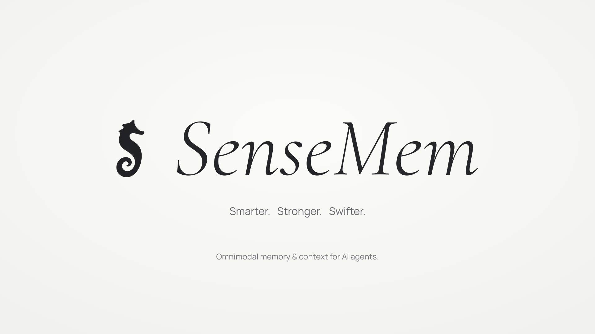

<!-- markdownlint-disable MD033 -->
<h1 align="center">
  
</h1>

<p align="center">
  <a href="https://github.com/SenseMem/SenseMem/actions/workflows/ci.yml">
    
  </a>
  <a href="LICENSE">
    
  </a>
</p>

<p align="center">
  <strong>Give your agents memory that lasts—and context that matters.</strong>
</p>

<p align="center">
  SenseMem is a unified context and memory layer for agents. It turns conversations, images,
  audio, and video into durable, searchable memory, then brings the right evidence back to the
  agent's current task.
</p>

<p align="center">
  <strong>Capture once. Remember across sessions. Build context for every task.</strong>
</p>

<p align="center">
  <a href="docs/quickstart.md">Quick start</a> ·
  <a href="docs/README.md">Documentation</a> ·
  <a href="docs/api/python-sdk.md">API reference</a> ·
  <a href="docs/benchmarks/results.md">Benchmark results</a>
</p>
<!-- markdownlint-enable MD033 -->

An assistant should remember where you left the spare key, recognize a changed preference, and
connect today's question with last week's conversation. SenseMem gives you the building blocks
for that continuity: preserve the original observation, organize what it means, retrieve it by
meaning and context, and deliver evidence your agent can use.

## Why SenseMem

- **One memory for every modality.** Store ordered text, images, audio, and video together.
  Original media stays attached to its observation, so recall can return the evidence itself.
- **Recall by meaning, time, place, and person.** Combine semantic and lexical search with
  event time, historical validity, identity, and spatial scope. Add semantic reranking through
  the same retrieval path.
- **Turn memory into useful context.** `search()` returns ranked evidence; `compile()` builds
  structured context within your budget; `ask()` generates grounded answers with evidence and
  explicit abstention.
- **Let memory evolve.** Optional formation derives entities, events, states, relationships,
  affect, and traits. Consolidation, correction, reinforcement, and reversible forgetting keep
  memory useful as information changes.
- **Keep capture responsive.** `capture()` saves an observation before inference;
  `settle()` enriches it on your schedule. Stream helpers connect continuous audio, vision,
  and interaction input to the same memory lifecycle.
- **Own your data and model choices.** Run embedded with local storage and local or remote
  model backends. SQLite and original media preserve authoritative state; the search index
  rebuilds from stored embeddings without another embedding pass.

The SDK, REST, MCP, and CLI share one memory kernel. Start embedded, connect an agent through
MCP, or serve HTTP clients from the same runtime.

## Get started

Install the local model integration:

```bash
pip install "sensemem[local]"
```

Store a fact and retrieve it—no database service or model API key required:

```python
from sensemem import Memory

with Memory.from_config(
    {
        "data_dir": "./data/my-agent",
        "embedding": {
            "provider": "sentence-transformers",
            "model": "google/embeddinggemma-2",
        },
    }
) as memory:
    memory.add("The spare key is in the blue toolbox.")
    hits = memory.search("Where is the spare key?", limit=3).hits
    print(hits[0].content)
```

```text
The spare key is in the blue toolbox.
```

The first run downloads the embedding model. Your memory persists in `data_dir`; run the
example again to reopen it. Repeating the same input returns the existing record.

The [quick start](docs/quickstart.md) takes you through persistence, grounded answers, and
multimodal input. To use a model endpoint, install `sensemem[openai]` and follow
[configuration](docs/configuration.md). Use `uv add` in place of `pip install` in a uv project.
Runtime requirements and the full extra catalog live in the
[installation guide](docs/configuration.md#1-install-only-the-surfaces-you-use).

## From stored evidence to agent context

Choose the output your application needs:

| Operation | What your agent gets | Use it for |
| --- | --- | --- |
| `search(query)` | Ranked memory hits and their source assets | Retrieval, inspection, and your own downstream logic |
| `compile(goal)` | Budgeted sections for actors, facts, episodes, procedures, affect, and traits | Building an agent's prompt from structured evidence |
| `ask(question)` | An answer, evidence hits, and abstention state | Grounded question answering with a configured generation model |

All three use the same retrieval and authoritative visibility rules. Your application chooses
the models, goals, prompts, and actions; SenseMem manages memory, evidence, and context delivery.

## Built for real applications

**Personal assistants** retain preferences, commitments, and events across sessions.
**Multimodal agents** connect conversations with photos, recordings, and video.
**Device applications** supply finalized observations from tools, cameras, glasses, or robots.

Time-aware memory separates when an event happened, when a claim was valid, and when the system
learned it. Evidence-linked operations let you inspect and reverse memory changes. Local identity
analysis connects voice and face observations with explicit naming and consent operations.

Deploy one owner per physical data directory. Share that owner through a transport when several
clients need access. For a network deployment, configure authentication and TLS at the host boundary.
See [product capabilities](docs/product-capabilities.md), [deployment](docs/deployment.md), and
[security](SECURITY.md).

## Measured on multimodal memory tasks

SenseMem's native multimodal MOSAIC configuration reaches **77.76% mean judge score** across
784 answerable questions from 70 persona histories. It sends original images, audio, and video
directly to the embedder and reader, with no separate captioner or speech recognizer.

On ATM-Bench Main, the evaluated evidence-operation configuration reaches **79.63% mean
Question Score** across all 1,013 questions. These measurements cover the configured memory,
embedding, retrieval, and reader combination.

See [benchmark results](docs/benchmarks/results.md) for models, scoring populations, and the
MOSAIC reproduction recipe. The [benchmarking guide](docs/benchmarking.md) shows how to evaluate
your own configuration and compare changes.

## Find your next step

| Goal | Guide |
| --- | --- |
| Store and retrieve your first memory | [Quick start](docs/quickstart.md) |
| Understand the memory model | [Core concepts](docs/concepts.md) |
| Choose models and optional capabilities | [Configuration](docs/configuration.md) |
| Integrate an agent or application | [SDK](docs/api/python-sdk.md) · [REST](docs/api/rest.md) · [MCP](docs/api/mcp.md) · [CLI](docs/api/cli.md) |
| Build a bounded prompt context | [Context compilation](docs/context-compilation.md) |
| Capture continuous input | [Streaming and interaction memory](docs/omni-streaming-and-interaction-memory.md) |
| Operate and recover an instance | [Operations](docs/operations.md) · [Troubleshooting](docs/troubleshooting.md) |
| Understand or extend the kernel | [Architecture](docs/architecture.md) · [Plugin architecture](docs/plugin-architecture.md) |

Browse the [documentation index](docs/README.md) for the complete learning and reference paths.

## Contribute

Help improve memory quality, integrations, examples, and documentation.
[Contributing](CONTRIBUTING.md) covers development setup and validation. Participation follows
the [Code of Conduct](CODE_OF_CONDUCT.md); report vulnerabilities through [Security](SECURITY.md).

## Cite SenseMem

If you use SenseMem in research or technical work, cite the version you evaluated:

```bibtex
@software{sensemem_2026,
  author  = {{SenseMem contributors}},
  title   = {SenseMem: A Unified Context and Memory Layer for Agents},
  year    = {2026},
  version = {0.3.0},
  url     = {https://github.com/SenseMem/SenseMem}
}
```

## Acknowledgements

SenseMem builds on SQLite, Zvec, Pydantic, OpenTelemetry, and the model and transport projects
listed in [configuration](docs/configuration.md). We thank their maintainers and research
communities. Benchmark attributions are preserved in the
[scorer notices](src/sensemem/benchmarks/_official/NOTICE.md).

## License

SenseMem-authored code and documentation use the [Apache License 2.0](LICENSE).
Models, datasets, and vendored benchmark material retain their own terms.
