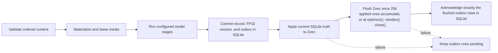

# Architecture

Jump to [code layout](#code-layout), [durable state](#durable-state), [write consistency](#write-consistency), [retrieval](#retrieval-consistency), [concurrency](#ownership-and-concurrency), [model boundary](#model-boundary), or [trust boundaries](#public-and-trust-boundaries).

SenseMem keeps durable evidence and task-specific context in one embedded runtime. SQLite and original media preserve authoritative state, a rebuildable Zvec index accelerates retrieval, and typed model backends provide replaceable inference. The host constructs one `Memory`, supplies backends, and controls process and transport policy.

This page defines implementation invariants. See [core concepts](concepts.md) for the user model, [deployment](deployment.md) for topology choices, and [operations](operations.md) for runbooks.

## System boundary

| Component | Responsibility |
| --- | --- |
| `Memory` / `AsyncMemory` | Validate policy and backend contracts once, open storage in order, wire the kernel planes, and forward every public operation to the owning plane. |
| Kernel planes (`sensemem.kernel`) | One object per concern—write, retrieval, answering, compilation, identity, control, records, perception, projection—each constructed with explicit dependencies. |
| Model backends | Embed, generate, transcribe or analyze speech, analyze faces, describe images, propose typed formations, segment events, rerank, or propose control-plane operations. |
| `LocalStore` | Persist authoritative records, FP32 embeddings, analysis and identity state, store metadata, and the index outbox in SQLite over one connection pool. |
| `AssetStore` | Persist immutable image, video, and audio bytes by SHA-256. |
| `ZvecIndex` | Maintain rebuildable dense, lexical, type, and event-time search projections. |
| REST, MCP, and CLI adapters | Translate protocol requests and call the same `Memory` kernel. |

One physical `data_dir` is one memory domain and has at most one live owner. Metadata is application data, never an account, authorization, request, or isolation boundary.

## Code layout

Public values live in domain modules (`content.py`, `records.py`, `semantics.py`, `identity.py`, `context_values.py`, `stream_values.py`, `types.py`), re-exported from `sensemem`. `memory.py` holds the `Memory` and `AsyncMemory` facades; `Memory.__init__` resolves settings and backends, opens storage, reconciles store metadata via `Recovery`, opens Zvec, constructs the remaining planes, and drains pending index work.

| Module | Plane | Owns |
| --- | --- | --- |
| `kernel/lifecycle.py` | `Lifecycle` | Operation leases, fork detection, close coordination, and active media leases. |
| `kernel/execution.py` | `Execution` | Bounded worker pools, asynchronous submissions, route concurrency, and pinned answer-stream workers. |
| `kernel/materialization.py` | `Materializer` | Validating caller content and leasing media before any model runs. |
| `kernel/hydration.py` | `Hydrator` | Converting stored rows to public `MemoryRecord`, `SearchHit`, and `AssetRef` values. |
| `kernel/recovery.py` | `Recovery` | Validating store representation markers, replacing derived indexes, and checkpointing startup recovery. |
| `kernel/speech.py`, `vision.py`, `embedding.py` | `Speech`, `Vision`, `Embedding` | Perception planes: transcripts and voice identities; descriptions and faces; content routing and embedding keys. |
| `kernel/projection.py` | `Projection` | Applying committed SQLite truth to Zvec via the outbox, batched flushes, `reindex()`, and `optimize()`. |
| `kernel/querying.py` | `Querying` | Validating query-policy plans and executing required and optional embedding routes. |
| `kernel/candidates.py` | `Candidates` | Executing bounded native reads and resolving external candidate references against SQLite. |
| `kernel/retrieval.py` | `Retrieval` | Query preparation, candidate expansion, authoritative hydration, scoring, and reranking shared by search, answer, compile, and control. |
| `kernel/formation.py` | `Formation` | Running the formation backend over committed sources and committing accepted proposals. |
| `kernel/identity.py` | `Identities` | Naming, consent, linking, unlinking, and erasing people. |
| `kernel/ingestion.py` | `Ingestion` | `add`, `add_many`, `capture`, `settle`, and streamed observations. |
| `kernel/processing.py` | `IngestionStages` | Ordered ingestion-stage execution and labelled interpretation attachment. |
| `kernel/recall.py` | `Recall` | Bounded recall planning, read execution, linked expansion, and corpus summaries shared by answering and compilation. |
| `kernel/answering.py` | `Answering` | Generation routing, answer rounds, and streamed answer validation (evidence packing lives in `kernel/grounding.py`). |
| `kernel/compilation.py` | `Compilation` | Evidence closure over lineage, consent, and actors, plus budget admission and rendering. |
| `kernel/control_plane.py` | `ControlPlane` | Proposing, applying, auditing, and reversing memory-management operations. |
| `kernel/records.py` | `Records` | `get`, `list`, `delete`, `export`, retention, and reinforcement. |

Pure helper modules beside the planes (`content.py`, `derived.py`, `formation_rules.py`, `grounding.py`, `temporal.py`, `ranking.py`, `predicates.py`, `evidence_policy.py`) read no storage and call no model. Built-in model instructions and text composers live in pure `prompts/` modules.

`infrastructure/local/store/` exposes `LocalStore` over one SQLite connection pool with eight table families (`records`, `captures`, `semantics`, `control`, `identities`, `media`, `index`, `recall`). `api/responses.py` defines the shared Pydantic response shapes for REST, MCP, and CLI. Benchmark packages under `src/sensemem/benchmarks/` are leaves that call the public SDK; no product module imports them.

## Durable state

| Path | Authority | Recovery role |
| --- | --- | --- |
| `state.sqlite3` | Authoritative | Records, FP32 embeddings, store metadata, cached analyses, identities, typed semantics, bitemporal versions, formation progress, capture queue, operation log, and index outbox. |
| `assets/` | Authoritative | Immutable original media bytes stored by SHA-256 digest. SQLite cannot recreate a missing asset. |
| `zvec/` | Derived | Disposable search projection; can be deleted while stopped and rebuilt from SQLite without re-embedding. |
| `.sensemem.lock` | Coordination only | Operating-system lock target; its presence on disk does not imply a live owner. |
| `.asset-staging/` | Transient | In-progress content-addressed writes, cleaned on open. |

SQLite uses WAL, foreign keys, `synchronous=FULL`, and `BEGIN IMMEDIATE` for writes. `AssetStore` writes and fsyncs a staging file before publishing under its digest so identical bytes share one object. Backups must capture `state.sqlite3` and `assets/` together; see [backup](operations.md#backup).

The store records embedding space and dimension, transcription space, configured face spaces, ingestion-stage recipe, and index recipe. Incompatible spaces fail at open rather than mixing vectors. Changing index quantization rebuilds Zvec from stored FP32 vectors; changing an embedding or derivation space requires replaying sources into a fresh directory.

## Write consistency

Media is copied to `assets/` before any model runs. SQLite triggers enqueue an upsert or delete for each embedding mutation. SenseMem commits SQLite before modifying Zvec and acknowledges outbox rows only after the Zvec flush succeeds. Applied rows are immediately searchable; flushing batches every 256 applied rows, on deletions, during `optimize()` and `reindex()`, and at `close()`. Startup, writes, deletes, search, and maintenance drain pending work.

- Validation or model failures before SQLite commit create no record; unreferenced media cleans up when its operation lease ends.
- A Zvec mutation or flush failure leaves SQLite committed and the outbox pending for retry.
- Stale IDs in Zvec cannot resurrect deleted records because final hydration reads SQLite.

`delete()` removes the record, its dependent semantics/versions/evidence/embeddings, and orphaned assets in one transaction, enqueuing Zvec deletion through the outbox. Anonymous identities with no remaining observations are removed; named or merged identities survive until `forget_identity()`. `memory_operations` remains append-only so rollback stays sound.

A memory ID is the SHA-256 digest of canonical ordered content, media digests, metadata, event time, memory type, and observation context, making repeated adds idempotent. `add_many()` uses one model batch and SQLite transaction; `add_stream()` commits each item individually and groups Zvec projection in bounded batches (32 items or 250 ms).

### Deferred capture

`capture()` validates content, materializes media, and commits the record and a `capture_queue` row before any model call. Captured records are readable via `get()`/`list()` but remain absent from search until host-scheduled `settle()` runs the shared enrichment, embedding, projection, and formation routine. Derived text appends behind per-asset markers (`[transcript:<id>]`, `[visual description:<id>]`, `[facts:<id>]`, `[speech identities:<id>]`) so caller text stays byte-identical at the front. Failed rows retain their attempt count and error reason; rows hitting `max_attempts` are skipped unless named explicitly in `settle(memory_ids=...)`.

### Formation and identity binding

`FormationBackend` proposes typed assertions after the source commits; the kernel validates modality, spatial frame, citations, and conflicts before committing derived records, evidence clauses, versions, embeddings, and outbox rows together. Failed formation leaves the source durable and retryable via `settle()`.

`memory_semantics.identity_id` binds typed claims to recognized identities through cited, visible naming assertions. Naming updates compute refreshed speech vectors outside the SQLite write lock using a rollback-only preview snapshot, then verify and commit names, evidence, documents, vectors, operation log, and outbox atomically—if the snapshot changed, the operation fails as stale without committing partial state.

## Retrieval consistency

```mermaid
flowchart LR
    query["Validate and prepare query"] --> embed["Embed aggregate and focused keys"]
    embed --> sync["Drain durable outbox"]
    sync --> routes["Run dense and lexical Zvec routes"]
    routes --> hydrate["Hydrate candidate IDs from SQLite"]
    hydrate --> filter["Discard stale IDs and apply authoritative filters"]
    filter --> rank["Collapse, rank, and hydrate final records"]
    rank --> hits["Return SearchHit values"]
```

`retrieval_mode` selects `hybrid` (dense + lexical), `dense`, or `lexical` (no query embedding). Zvec proposes candidates; SQLite hydrates records and enforces hard event-time, bitemporal (`valid_at`, `known_at`), symbolic `place_id`, `identity_id`, same-frame metric spatial, visibility, and forgetting filters.

Each route begins at a fixed depth (100 parents unquantized; 200 parents quantized) and widens up to `max(initial_depth, 129 * limit)` when authoritative filters thin survivors. Quantized candidates and lexical-only hybrid hits receive exact cosine scoring against stored FP32 vectors before relevance gating and ranking. Ranking combines dense relevance, IDF-weighted lexical overlap, temporal proximity, optional decay, and reinforcement.

`search()`, `ask()`, `compile()`, and the control plane share this retrieval path. Optional recall planning, semantic query expansion, and linked evidence expansion reuse the same SQLite visibility and budget rules.

## Ownership and concurrency

Opening a store acquires a non-blocking OS lock for the lifetime of `Memory`; a second owner on the same directory fails immediately with `reason="data_dir_in_use"`, and a `Memory` cannot cross `fork()`. Process-wide budgets bound open stores, connections, workers, and materialized input bytes; see [runtime limits](runtime-limits.md).

Model calls run outside SQLite write transactions and outside the process-local write lock. Retrieval holds the write lock only while hydrating records, leasing candidate media, and opening a WAL snapshot for FP32 rescoring; scoring and ranking run outside the lock. Media leases protect active searches and answers from concurrent deletion until the operation completes. Plain-text candidate/record read caches reuse stable working sets within a write generation and invalidate on any write commit or rollback.

`reindex()` rebuilds Zvec from SQLite pages and replays concurrent outbox writes. `close(timeout_seconds=30.0)` rejects new work, drains active operations, releases leases, flushes and merges segments when modified, and closes each unique backend once. `AsyncMemory` delegates to the synchronous core through bounded worker pools.

## Model boundary

Extension protocols (`EmbeddingBackend`, `GenerationBackend`, `StreamingGenerationBackend`, `TranscriptionBackend`, `SpeechBackend`, `VisionDescriptionBackend`, `VisionAnalysisBackend`, `FaceBackend`, `FormationBackend`, `RerankingBackend`, `ConsolidationBackend`, `EventSegmentationBackend`) keep storage authority in the kernel. `GenerationRouter`, `EmbeddingRouter`, and `EvidenceGeneration` compose multiple models and media/metadata enrichment behind those same protocols.

The bundled OpenAI adapters (`OpenAIEmbedder`, `OpenAITranscriber`, `OpenAICompletion`, `OpenAIAgent`) delegate authentication, HTTP transport, timeouts, and network retries to caller-owned official OpenAI SDK clients, adding at most one semantic JSON retry on malformed HTTP 200 responses (never on refusals or truncation).

Computation plugins (`QueryPolicy`, `CandidateSource`, `RankingPolicy`, `ContextSelector`, `IngestionStage`) use the same public protocols for built-in defaults and custom extensions while the kernel retains identity, validation, closure, consent, budgets, and transactions. See [computation plugins](api/python-policies.md) and [plugin factories](configuration/plugins.md).

## Public and trust boundaries

Validate caller inputs once at the owning boundary and pass typed values inward. Model and plugin outputs are untrusted data and undergo structural and semantic validation before affecting durable state.

Supported Python imports come from `sensemem`. Transports expose explicit subsets over the same `Memory`:

- **REST (`/v1`):** fourteen always-on routes plus nine opt-in routes gated by `identity_operations` and `embodied_operations` (both default `False`).
- **MCP:** thirteen tools grouped under `identity_operations`, `embodied_operations`, and `write_operations` (all default `True`), plus one read-only asset resource template.
- **CLI:** 32 local product commands plus `doctor`; `--url` targets the REST surface.
- **Control plane:** `consolidation_candidates`, `consolidate`, `consolidate_pending`, `apply`, `record_outcome`, `forget`, `rollback`, and `operations` remain owner-process only (SDK and local CLI), with no REST route or MCP tool. A server host can schedule periodic `consolidate_pending()` via `deliberate_every`.

Python accepts local regular `Path` files; REST and MCP accept only inline bytes or existing asset IDs and reject server paths and remote URLs. No transport serializes provider exception bodies or credentials; REST additionally redacts storage, index, and internal error subjects.
