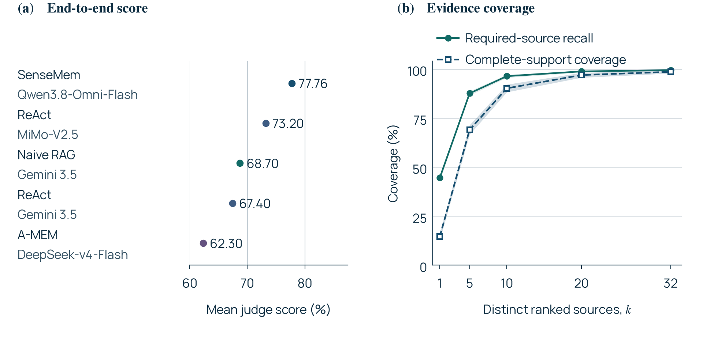
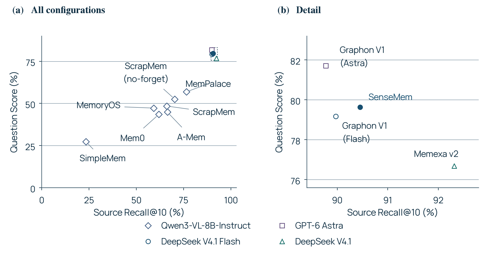

# Benchmark results

SenseMem is evaluated on tasks that connect a growing history with a concrete question.
The configurations below exercise the complete path from ingestion and retrieval to a model's
answer.

## Native multimodal memory on MOSAIC

**SenseMem reaches 77.76% mean judge score on 784 answerable questions across 70 persona
histories.** Original images, audio, and video go directly to the embedder and reader. This
configuration preserves native media throughout recall without a separate captioner, speech
recognizer, or reranker.

| Setting | Evaluated configuration |
| --- | --- |
| Embedding | `google/embeddinggemma-2`, 768 dimensions, served by vLLM |
| Reader | `qwen3.8-omni-flash`, thinking disabled |
| Judge | `qwen3.7-plus` |
| Input | Text, images, audio, and video |
| Dataset | 923 questions: 784 answerable and 139 unanswerable, across 70 personas |
| Headline metric | Answerable-only mean judge score, 0.777551 |
| Measurement date | 2026-11-06 |

The measured configuration also scores **83.76% on temporal reasoning** and **82.75% on
information extraction**. These task breakdowns cover time-sensitive questions and specific
details drawn from multimodal history.

*From the SenseMem technical report, Figure 5. Panel (a) shows the top five configurations in
the 2026-11-09 leaderboard snapshot; reader models differ across configurations. Panel (b)
measures source coverage over 784 answerable questions as the number of distinct ranked sources
increases. Shading gives 95% persona-cluster bootstrap intervals from 2,000 resamples over
70 personas, conditional on fixed predictions.*

Follow the [MOSAIC reproduction guide](mosaic-native.md) for service setup and full-run commands.
The [configuration](../examples/mosaic-embeddinggemma2-qwen38.yaml) and
[measurement summary](runs/mosaic-native-2026-11-06.json) preserve the scoring populations,
model-service information, and input identities.

## Evidence-grounded answers on ATM-Bench

**The evaluated SenseMem configuration reaches 79.63% mean official Question Score across
all 1,013 ATM-Bench Main questions.** It combines multimodal retrieval and reranking with
source-bound evidence operations for selection, counting, and arithmetic.

| Question family | Score |
| --- | ---: |
| Number | 81.39% |
| List | 78.87% |
| Open-ended | 78.60% |
| Overall | 79.63% |

The configuration uses `tencent/WeMM-Embedding-9B` embeddings, `Qwen3-VL-Rerank-8B` reranking,
`deepseek-v4.1-flash` with maximum reasoning effort, and `gpt-5-mini` for open-ended judging.
It enables concise text answers, `image_source_prose: context_when_supplied`, and
`evidence_operation_tool: true`, with recall limit 20, two recall rounds, two query expansions,
and 64,000-character evidence allowances.

This measurement belongs to the
[evaluated source revision](https://github.com/SenseMem/SenseMem/commit/ddb85e7e67fa86a41e34e2b763d783e51426704c).
See [ATM-Bench protocols](tasks.md#atm-bench-and-mem-gallery) for input conditions and scoring,
and [provider fields](../configuration/providers.md#answer-presentation) for the answer controls.

*From the SenseMem technical report, Figure 6: the SenseMem submission and ten published
reference configurations, retrieved 2026-11-11, on the 1,013-question Main workload. Panel (b)
enlarges the four configurations above 75% Question Score; marker shapes identify answer models.
SenseMem scores 79.63% Question Score and 90.45% source-ID Recall@10. These are historical
configuration comparisons; model and input choices are part of each result.*

## Use results to choose a configuration

Use these measured embedding, memory, retrieval, reader, and judge combinations as starting points
for your application. Each section names its metric and scoring population. Reader and judge IDs
are service aliases; retain resolved revisions with new measurements when available.

Both headline measurements are single runs. Evaluate changes with matching inputs and models,
baseline arms, and paired comparisons as described in [Benchmarking](../benchmarking.md).
