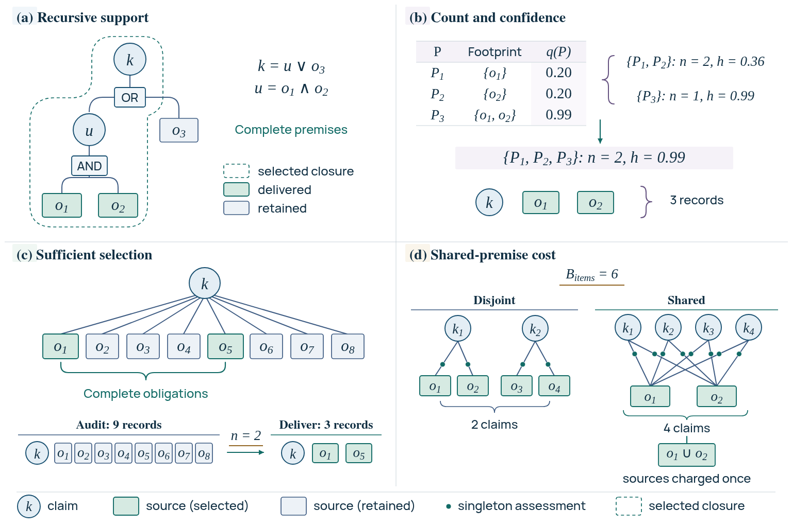

# Context compilation

Give your agent structured memory that fits its context budget. `memory.compile(goal)` selects
evidence and returns a `ContextBundle` organized into actors, facts, events, procedures, affect,
and traits, with conflicts and missing-context notes.

Use the bundle in your own prompt or workflow. Compilation needs no generation model;
`ask()` adds grounded answer generation when you want SenseMem to produce the answer.

## Compile a first bundle

Install the [local embedding extra](configuration.md#1-install-only-the-surfaces-you-use).
This example needs no generation model:

```python
from sensemem import ContextBudget, Memory

config = {
    "data_dir": "./data/compile-example",
    "embedding": {
        "provider": "sentence-transformers",
        "model": "google/embeddinggemma-2",
    },
}

with Memory.from_config(config) as memory:
    memory.add("The spare key is in the blue toolbox.")
    bundle = memory.compile(
        "Where is the spare key?",
        budget=ContextBudget(max_chars=2000, max_items=8),
    )
    print(bundle.render())
    print(bundle.unknowns)
```

`bundle.hits` holds complete records; `bundle.render()` produces prompt text. Keep `unknowns`
and conflict notes with that text so missing evidence remains visible. `AsyncMemory` provides
the same operation. REST uses `POST /v1/context`, MCP uses `compile_context`, and the CLI uses
`sensemem compile`.

Both `render()` and `compact().text` mark memory content, including procedures, as untrusted
evidence. Pass these presentations as task context in a user or tool message, keeping host
instructions separate. Retrieved text cannot grant permission to change policy or take actions;
use the current request and host policy for that authority. Preserve relevant uncertainty, and
do not treat omitted or unretrieved memories as proof that a fact is absent.

## Contract

```text
compile(
    goal: ContentInput,
    *,
    budget: ContextBudget | None = None,
    reference_at: datetime | None = None,
    scope: RetrievalScope | None = None,
    allow_partial_sources: bool = False,
    supplements: Sequence[ContextSupplement] = (),
) -> ContextBundle
```

Compilation starts with one retrieval round with candidate depth `max(100, 3 * budget.max_items)`,
tripled when `min_confidence` or `freshness` is set. Each requested memory type gets its own
index route; selecting every type uses the unfiltered route. Confidence and freshness filter
the returned window. Scope, relative time, and authoritative SQLite visibility match search.

Compilation preserves conflicts for the host to resolve and never generates an answer.
By default it uses only the original retrieval round. Spoken-query preparation
may cache a transcript; an empty bundle records a bounded query-failure signal. Neither creates
a memory record. Counts describe the candidate window, and a full window that still loses
evidence reports `candidates_exhausted`.

### Temporary context from an application or agent

Pass completed tool results or agent observations as `ContextSupplement` values. They are
request-local evidence with an explicit source, not memory records or instructions. Compilation
does not embed, form, or persist them:

```python
from sensemem import ContextBudget, ContextSupplement

bundle = memory.compile(
    "What should I bring?",
    budget=ContextBudget(max_chars=4000, max_items=8),
    supplements=(ContextSupplement("Rain is forecast this afternoon.", source="weather-tool"),),
)
print(bundle.render())
```

The host decides whether and when to run its agent. An async supplier can use
[`AsyncContextSource`](api/python-streams.md#asynccontextsource) while the pipeline continues,
then pass its completed supplements to `AsyncMemory.compile()`. No background service is required.

Supplements take character and item slots in submission order before stored evidence is packed.
Stored assertions still require their complete evidence closures. Both sources share one budget;
an oversized supplement is skipped so a later smaller one can fit. `observed_at` and `expires_at`
must be timezone-aware when supplied. A supplement is excluded if it has expired at `reference_at`,
has not yet been observed, or fails the requested freshness window; freshness requires an
observation time. `bundle.supplements` holds the admitted values, and `omitted_supplements` plus
`unknowns` explain exclusions. They do not count as memory citations, identity evidence, or
selected proofs. `compact()` preserves their source labels without creating memory aliases.

REST's `supplements` array and MCP's `compile_context` parameter accept the same fields.
Keeping a supplement requires an explicit later `add()` or `capture()` chosen by the host.

### Goal-directed recall

With `recall_planning=True` and a planner-capable answerer, compilation also executes one bounded
recall program for the goal. For a trip brief, that program can look separately for dates,
passport expiry, and meal requirements. `recall_query_expansion=True` permits focused semantic
queries; the same `recall_max_queries`, `recall_set_budget_chars`, and `recall_set_max_rows`
limits used by answering apply. `evidence_expansion=True` additionally offers linked evidence.
There are no answer generation or replanning rounds.

Planned reads precede the original ranking for selection. No original hit reserves a mandatory
budget slot, and the compiler applies its normal source closure, scope, consent, filters, and final budgets.
Scores remain local to each query and are not fused. A deadline can skip planning before it starts;
it does not cancel a running model request.

An unavailable or invalid planner retains the original evidence and reports `stage_skipped`.
Empty planned reads report `evidence_unavailable`; truncated or failed reads and supplemental
limits report `candidates_exhausted`. These describe read execution, not a semantic verification
of every requirement in the goal. A nonempty similarity result can still be irrelevant, and
neither a successful program nor an empty `unknowns` list certifies a complete task brief.
Evaluate coverage for the goals your agent serves and preserve these notes in its context.

## Budget

| Field | Default | Meaning |
| --- | --- | --- |
| `max_chars` | `16000` | Ceiling on priced grounding, including text and media weights |
| `max_items` | `24` | Complete memories, excerpts, and admitted temporary supplements |
| `max_media_items` | `None` | Delivered native-media cap; `0` permits text-only source projections |
| `memory_types` | `None` | Exact type filter pushed into retrieval |
| `min_confidence` | `0.0` | Typed confidence threshold; untyped observations count as `1.0` |
| `freshness` | `None` | Positive `timedelta` relative to event end, event start, then creation time |
| `max_latency_ms` | `None` | Positive deadline for skipping optional enrichment |
| `selected_proofs` | `False` | Deliver selected current-knowledge witnesses instead of the full audit union |

Character/item/deadline bounds are positive integers, the media cap is non-negative, and confidence
is in [0,1]. `reference_at` supplies the clock for relative time and freshness.

### Character accounting

| Grounding component | Charge |
| --- | --- |
| Full memory line | Rendered line plus newline, including ID, confidence, and validity |
| Excerpt line | Rendered line plus newline, including warning, source ID, and offsets |
| Text-only projection | Complete rendered parts, source ID, role labels, and omitted-media declaration; no native-media weight |
| Header and section headings | Rendered characters; the budget line is priced at its widest |
| Image / audio / video asset | 2000 / 4000 / 12000 characters |
| Asset with unresolved modality | 4000 characters |
| Named/provisional actor and selected-proof lines | Rendered characters and their headings |
| Temporary supplements | Rendered source, content, timestamps, and their section heading |

These are conservative packing weights, not provider token counts. Repeated assets in distinct
records may be charged more than once. A video needs at least 12000 characters plus its text.
The header is mandatory; a ceiling below its goal-dependent minimum raises `ValidationError`.

### Text-only sources for media

The compiler tries complete media records first. A record with two videos costs at least 24000
characters; two audio parts add another 8000. Such an event cannot enter the default
16000-character bundle whole. When a raw observation has text parts, the compiler can instead
deliver a `ContextProjection` in `bundle.projections`, under `Text-only sources`. This fallback
also applies to `max_media_items=0`. It needs no `allow_partial_sources` option.

A projection retains its `source_memory_id`, complete ordered `parts`, timestamps, context, and
`coverage="text_only"`. Original text, derived transcripts, visual descriptions, and model
interpretations retain their distinct roles. Every asset position remains an explicit omitted
media placeholder; `omitted_assets` supplies unique asset descriptors without local paths.
Repeated media positions stay repeated in `parts`. The projection does not contain native media.

Each projection spends one item slot and its full rendered character cost, including role labels,
warnings, and media placeholders. Text is not truncated. A media-only record with no text, or a
projection whose complete text still exceeds the budget, remains excluded. `budget_excluded`
reports omitted native-media parts. An empty `bundle.hits` can therefore accompany useful
`bundle.projections`; it does not establish that retrieval found no memory.

This fallback applies only to an observation whose required closure is that observation alone.
It cannot replace a source required by a derived assertion, discharge a selected proof, or hide
a required conflicting claim. Full hits, exact raw excerpts, and projections of one source are
mutually exclusive. A later admission of the complete source replaces its projection atomically.
Scope, consent, temporal visibility, and budget filters still apply. An omitted native identity
observation does not add named or provisional actors by itself.

An interpretation describes model output, not verified perception of its omitted originals.
Keep the text-only citation coverage and warnings when consuming or compacting the bundle.
Inspect native media separately or admit the complete record before claiming to have seen or
heard it. A larger explicit budget is a full-delivery control, not a prerequisite for this fallback.

`chars` upper-bounds priced grounding. Without diagnostic appendices,
`len(bundle.render()) <= bundle.chars <= max_chars`. Conflict/unknown blocks and the
`Omitted:` trailer are outside the ceiling so a thin bundle still explains its omissions.
Compaction does not reclaim this budget.

### Deadline

The compiler checks the deadline after section assembly, before optional conflict reporting and
affect/event enrichment. It does not cancel work already running. Mandatory evidence and
candidate-conflict closure still apply. Skipped stages produce `stage_skipped` unknowns;
`elapsed_ms` starts before retrieval and `deadline_exceeded` reports whether the deadline passed.

## Sections

Typed kind selects the section first; generic records fall back to their memory type.

| Section | Records |
| --- | --- |
| `actors` | Entities and recognized named/provisional identities |
| `relationships` | Relations |
| `scene` | States |
| `facts` | Other semantic records |
| `episodes` | Episodic records except affect |
| `procedures` | Procedural records, including response policies |
| `affect` | Affect cues |
| `traits` | Traits |

Types and kinds differ: event/affect are episodic, response policy is procedural, and other derived
kinds are semantic. Type filters can therefore exclude entire sections. Facts, episodes, and
procedures work without formation; the other sections need typed records or recognition evidence.

For independent flat candidates, rank fills the top half of `max_items`; remaining slots give
one place to each missed section only when all spanned sections can receive one. Otherwise rank
controls the whole selection. Remaining places fill by score, and a cheaper candidate may fit after
an oversized one. Derived closures or conflicts instead require strictly ranked atomic groups.

The bundle also reports included-hit/excerpt event bounds, sorted spatial `frames` and symbolic
`places`, complete `hits` in rank order, and `excerpts` in selection order. Evaluate section
coverage and downstream task quality when choosing a budget for your application.

## Evidence-closed selection

A derived assertion is admitted with its complete recursive `context.evidence_ids` closure.
Every source must satisfy scope, type, confidence, freshness, active/known-time, and applicable
consent rules. Missing, filtered, cyclic, or traversal-bounded support withholds the assertion
and reports `evidence_unavailable`. The default closes the full flattened audit union.

Closures spend item, character, and media budgets atomically; shared records count once.
Supporting records receive retrieval score zero. Candidate-known conflict representatives bring
their own closures. Source pointers establish provenance, not semantic entailment. Affect/event
co-occurrence never becomes a support or causal edge.

`ask()` and `ask_stream()` use the same full source closure, under their separate soft evidence
allowance. Their `limit` counts ranked anchors, not supporting records. See
[answer grounding](api/python-memory.md#answer-grounding).

### Selected delivery certificates

`ContextBudget(selected_proofs=True)` enables current-knowledge `bundle.proofs`. A
`ContextProof` contains acyclic `ContextProofNode` witnesses for complete AND assessments and
raw captures. Count and confidence can require different witnesses, including three or four
proofs together. Intermediate claims must justify their delivered confidence. Shared captures
stay one group; alternative paths within one assessment do not establish another observation.

`bundle.proof_scoring` reports the instance's existing evidence policy. It is not a compilation
request option. The SDK, REST, MCP, full text, and compact text retain the same rule:

| Rule | Count and score |
| --- | --- |
| `capture_groups` (default instance) | After excluding eligible naming conditions, singleton assessment members use their stored `source_group_id`. Each group contributes its maximum top-level assessment score; all groups combine by noisy-OR. Joint assessments remain one alternative with their maximum score. |
| `independent_pair` (`independent_evidence=True`) | Complete path footprints establish independence. Confidence is the maximum single-path or independent-pair score, with every path capped by its lowest node confidence. |

`ContextProofNode.source_group_id` is a SQLite-produced grouping declaration, separate from
`capture_id`. A derived source with alternatives spanning several groups can keep its own record
ID as its group even when delivery selects one alternative. The selected subset cannot recreate
that full-store grouping. Group declarations must agree across witnesses; a capture leaf's group
must match its capture. Grouping does not assert graph independence or calibrated probability.
In particular, distinct multi-capture summaries can share ancestors in default mode. The
independent policy still rejects those shared paths as independent corroboration.

For a model inference bound to a stable identity, bundle validation uses its delivered typed
contexts to recognize a matching host-confirmed naming condition. The complete naming proof
remains required and delivered; its branch does not count as an experience observation. A
capture shared through another observation path still prevents path independence. Inferred names,
other identities, and host-confirmed targets keep their ordinary proof semantics.
`ContextProof.structurally_independent_of()` compares complete structural footprints without this
typed context, so it can return false for witnesses that a condition-aware bundle correctly accepts.
No certificate field or AND member is removed.

Default selection can deliver three or more singleton groups to justify the stored score;
three assessments of .6 can therefore deliver .936. Independent selection retains the .84
maximum-pair score for those same three assessments. No stored score or visibility threshold is
changed to fit a delivery budget. Missing support or insufficient budget still withholds the claim.

Stored and returned `evidence_ids` retain the full audit union. The **Selected proofs** section
identifies delivered witnesses; references outside the bundle remain undelivered. Records count
once, certificate text is charged, and excerpts cannot discharge proof obligations. Consent and
conflict completion remain mandatory.

Per anchor, search reads at most 256 ancestry nodes and 4096 clause-member rows, retains at most
64 witnesses, and limits clause visits/joins to 4096 per search. Packing is heuristic. Omitted
alternatives produce unknowns; an uncertifiable or oversized witness union withholds the claim.
Historical `scope.known_at` retains full-closure delivery. This opt-in changes no stored record,
schema, or default policy.



*From the SenseMem technical report, Figure 4. Panels (a–c) illustrate selected
delivery certificates: every chosen AND assessment remains complete, and count and confidence
can need different witnesses. The nine-to-three-record example uses `selected_proofs=True`;
default compilation retains the full audit union. Panel (d) shows why shared sources support
more claims within the same item budget. These schematic record counts exclude character,
certificate-text, and media costs, which the compiler also enforces.*

## Exact raw excerpts

`allow_partial_sources=True` permits one exact dense-matched text projection when a newly written
pure-text raw observation cannot fit whole. The compiler tries the complete parent first. Only raw
text parts with stored selectors qualify; aggregate keys, lexical-only matches, media, and derived
records do not. The default `False` performs no selector read.

An excerpt appears in `bundle.excerpts`, never `hits`. A parent appears either whole or partial,
once. Each `ContextExcerpt` retains the parent, matched index ID, and digest-bound
`TextSpanSelector`. Its ordered `TextSpanPiece` values carry context/body role, half-open Unicode
code-point offsets, exact text, and digests. Combining characters may be split.

SQLite stores offsets/digests and hydration verifies the authoritative parent and reconstructed
embedding input. Verification failure disables the excerpt while preserving the record, vector,
and ordinary search. Excerpts inherit scope, temporal visibility, identity, and consent checks.

Rendering labels a partial source, shows its parent/offsets, and marks omitted spans with ellipses.
Keep the warning: omitted text may qualify or withdraw the selected statement. Excerpts are not
evidence-clause members or reinforcement citations. A later derived closure replaces an excerpt
only if the complete full-record closure fits atomically; otherwise the assertion is withheld.

### Compact presentation

`bundle.compact()` returns a frozen `ContextPresentation` with text and request-local symbols:
`mN` for memories, `iN` for identities. Symbols retain stable IDs, namespaces, structural roles,
and full/partial/text-only/reference-only coverage. Keep the exact symbol table with each request.

`resolve(symbol, namespace=...)` only decodes an alias. Unknown symbols or namespace mismatches
raise `ValidationError`. `resolve_citation(symbol)` accepts full, partial, and text-only memory
citations. It retains a selector only for exact partial text; text-only coverage does not attest
to omitted media. Reference-only and identity aliases are rejected. Aliases grant no
retrieval, evidence, consent, or scope authority and cannot replace stable SDK IDs.

Compaction follows selection. It leaves budgets, closure, `render()`, `hits`, and `document()`
unchanged. Goal/content/conflict/diagnostic text stays verbatim, so reversibility with the symbol
table does not establish semantic equivalence of arbitrary prompt text. REST, MCP, CLI, and
product answering do not select this presentation.

## Named and provisional actors

Included memories resolve their semantic identity or asset-level speech/face identity edge
without requiring a naming assertion to rank. Current naming uses the same valid/known-time view;
present consent withdrawal still suppresses historical actor rendering.

| Entry | Fields |
| --- | --- |
| `NamedActor` | `identity_id`, `name`, supporting included `memory_ids`, `naming_assertion_id` |
| `ProvisionalActor` | `identity_id` and supporting included `memory_ids`; no name |

An identity appears in only one group. A naming assertion already included as a ranked actor hit
does not list itself again as its own support. Actor entries are not hits and consume no item
slot. After ranked hits, their lines spend remaining characters in identity order, named before
provisional; omitted lines report `budget_excluded`. No entry survives without included evidence.

## Affect cues

`bundle.affect` holds `AffectCue`: hit fields plus `event_ids`. Its rendered line includes
basis, confidence, cue modality, optional valence [−1,1], arousal [0,1], source IDs, and co-occurring
event IDs. The basis distinguishes a user statement from model inference.

Source IDs render at most eight entries plus a remainder count; co-occurring event IDs are capped
at eight during construction, without a total count. The latter are sorted active events sharing
at least one source observation under the same visibility/scope bounds. One batched read after
selection resolves them; the deadline may skip it. Only IDs are carried: events take no extra
item/character budget and do not enter `episodes` unless selected independently.
**Shared observation means co-occurrence, not causation.**

### Attribution delivery

Typed `affect_target` and `affect_elicitor` relations enter `relationships` as separate claims.
Their rendered lines show the focal affect, target/elicitor role, affirmed/denied polarity,
object reference, basis, and any reporter/quote witnesses. An elicitor describes a sourced
explanation; a model's inference is not rendered as an established cause.

Before a ranked attribution or one of its dependent assertions can enter the bundle, the kernel
reads all active scoped assertions for the same affect/role/object group from SQLite. This is an
exact obligation lookup, so a low-ranked denial cannot disappear behind a high-ranked affirmation.
Unrelated objects and roles do not become a second relevance route. The group and its required
cue, object, and source evidence enter selection as one atomic closure; shared records count once.

The bounded lookup can withhold a group when it is truncated, a peer's evidence is unavailable,
or requested filters or consent prevent complete delivery. Item, character, and media limits
also apply to the whole closure. A passed compilation deadline withholds attribution rather than
returning an unchecked explanation. The bundle reports the applicable unknown; a cue that fits
its own evidence closure can remain in `affect`. The compiler makes no model call for attribution.
The existing optional `event_ids` hop retains its co-occurrence-only meaning.

## Conflicts

Functional lineages have one standing value: `STATE` and user-stated `TRAIT`. Different values
in accumulating relations or inferred traits do not automatically conflict.

For an eligible ranked functional claim, indexed SQLite reads complete its own lineage with
eligible competing values, never unrelated lineages or query-inferred competitors. Scope,
identity, place, spatial frame, valid/known time, source closure, and consent still apply.
Repeated copies of one value are alternatives; the first deliverable copy represents it.
Unranked required counterparts receive score zero.

All distinct representatives and their sources must fit atomically. An unavailable counterpart,
a value-cap overflow, or insufficient budget withholds every affirmative member and reports
`evidence_unavailable`. Type/confidence/freshness filters or consent cannot make a remaining
value look certain by hiding known competition. Superseded versions outside the temporal view
are excluded.

`conflicts` describes bounded eligible claims, not corpus-wide belief history. Use historical
search, operation history, or subject export for other views.

## Unknowns and rendering

| Unknown kind | Meaning |
| --- | --- |
| `budget_excluded` | A bound excluded candidates or actor lines |
| `evidence_unavailable` | Required support or conflict completion could not be delivered |
| `section_empty` | A requested type leaves a relevant section empty; absent kind-only sections are silent when their type is otherwise represented |
| `scope_empty` | Supplied scope matched nothing |
| `modality_unsupported` | Goal media cannot be searched by this composition |
| `stage_skipped` | Deadline skipped optional enrichment |
| `consent_withheld` | Current policy withheld actors; their source memories may remain eligible |
| `candidates_exhausted` | The full candidate window still lost evidence |

`render()` deterministically emits the goal, reading guide, reference time, budget, non-empty
sections in the order above, then applicable conflict/unknown blocks and an omission trailer.
`omitted == 0` says nothing was dropped inside the observed window, not that the store is empty
or all relevant evidence was found.

Discover configured operations through `memory.capabilities`; the
[SDK value reference](api/python-values.md#memory-capabilities) defines its fields.
