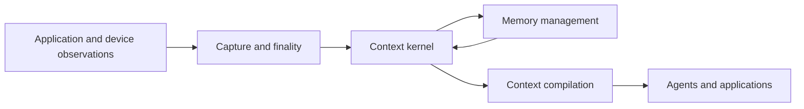

# Context OS direction

**Context OS** is SenseMem's design direction for connecting observation, memory, and action-ready
context. It gives a host agent a consistent memory lifecycle while the agent controls goals,
planning, tool selection, and actions.

The current runtime implements capture, deferred enrichment, evidence-linked memory management,
and context compilation. This page explains how they fit together and the goals that guide their
development. Use the [SDK](api/python-sdk.md), [configuration](configuration.md), and
[architecture](architecture.md) references to implement an integration.

## Product boundary

| Layer | Responsibility |
| --- | --- |
| Source integration | Normalize application or device events into immutable observations with explicit finality. |
| Capture | Separate changing working input, speculative recall, and durable observations. |
| Kernel | Enforce evidence, identity, time, space, version, and durability rules. |
| Memory management | Propose reinforcement, consolidation, correction, and cognitive forgetting within a bounded evidence window. |
| Context compiler | Select evidence for a goal within item, character, media, freshness, and confidence bounds. |
| Interfaces | Expose the same kernel through SDK, REST, MCP, and CLI contracts with explicit authority. |

Sensor drivers, VAD, localization, GPU scheduling, general agent planning, and the final action
remain application responsibilities.

## Consumers and authority

| Participant | Role |
| --- | --- |
| Developer or operator | Select models, connect sources, set policy, schedule maintenance, and recover the instance. |
| Agent | Use the capabilities the host grants to request context, submit observations, and report feedback. |
| Person represented in memory | Supply consent, naming, correction, export, retention, or deletion requests through the host application. |

The SDK provides explicit operations for these requests:

| Operation | Effect | Reversibility |
| --- | --- | --- |
| `record_consent()` | Record an identity-bound consent statement. | A later statement or rollback can replace it. |
| `register_identity()` | Assert a name and optional relationship for an observed identity. | Roll back its `IDENTIFY` operation. |
| `unlink_identity()` | Reverse a cross-modal merge. | Its logged correction can be rolled back. |
| `export()` | Read retained records, versions, identity information, and related operations for the selected subject. | Read only. |
| `apply_retention()` | Apply declared physical-deletion policy; preview with `dry_run=True`. | Physical deletion cannot be rolled back. |
| `delete()` / `forget_identity()` | Remove a live record or erase an identity template. | Physical deletion cannot be rolled back. |

Models cannot propose consent or cross-modal merges. Withheld or withdrawn consent prevents new
exemplars, cross-modal linking, and actor delivery for that person. Existing recognition and source
retrieval remain available; consent is not an access-control filter.

Exports can include recordings shared by several people. The host must review what it discloses;
the SDK does not redact other people from original evidence or implement a complete consent or
legal-rights workflow. See [data-subject operations](api/python-identity.md#data-subject-rights).

## Time scale is not memory type

Fast and slow describe when work runs. Semantic, episodic, and procedural describe a record's
cognitive role. They use one authoritative evidence model.

| Milestone | State | Work |
| --- | --- | --- |
| Working context | Transient | Coalesce partial text, audio, or frames and run speculative recall. |
| Durable capture | Authoritative source | Commit finalized content, media, provenance, and deferred work. |
| Search-ready memory | Indexed source | Transcribe, describe, embed, and apply the search projection. |
| Derived memory | Evidence-linked assertions | Form typed records and explicitly consolidate, correct, or forget them. |

These milestones do not require separate databases or stores.

### Fast context plane

`add()` completes the configured ingestion path and returns a searchable record. `capture()`
instead acknowledges the SQLite commit before any model call; the host later calls `settle()` to
enrich and index it. `pending_captures()` reports readiness and failures. A row awaiting only
formation can already be searchable.

Streaming helpers distinguish speculative `UPDATE`, durable `FINAL`, and discarded `CANCEL`
events. Capture mode keeps query-model work off the acknowledgement path. The host still owns
segmentation and settlement scheduling. See [streaming](omni-streaming-and-interaction-memory.md).

Measure acknowledgement, time to searchable, search latency, speculative first-hit latency, and
formation lag separately. A latency claim must identify payload, model, hardware, warm or cold
state, and required readiness level.

### Agentic memory control plane

Memory management gathers a bounded evidence set, requests proposals, validates them, and commits
accepted operations with an operation log. `consolidate()` performs one pass;
`consolidate_pending()` processes due candidates within a round limit.

Candidates arise from independent evidence, contradictions, feedback, repeated empty recalls,
declared memory pressure, or a host-approved idle window. Weighed markers prevent unchanged work
from being proposed on every pass. The host schedules the loop; configuring a backend alone
starts no timer.

Model proposals can reinforce evidence, consolidate, correct, cognitively forget, or propose an
evidence-backed name. Targets and sources must remain eligible at commit. The kernel refuses
unauthorized, stale, or inconsistent proposals. Physical deletion and consent remain host
operations. See the [memory management contract](api/python-control.md).

## Forgetting is three operations

| Form | Effect | Public mechanism |
| --- | --- | --- |
| Cognitive forgetting | Exclude a record from ordinary recall while retaining it for inspection. | `forget()` and reversible `FORGET` operations; decay separately changes ranking. |
| Consolidation forgetting | Retire source detail from ordinary recall while preserving the new record's evidence links. | A `CONSOLIDATE` operation with source `target_ids`; reverses with that operation. |
| Physical forgetting | Remove live records or identity templates. | `delete()`, `forget_identity()`, and explicit retention passes. |

Validity expiration is another retrieval constraint: a historical `valid_at` can still reach an
expired assertion. None of these mechanisms guarantees secure erasure from operation payloads,
storage remnants, snapshots, or backups. [Memory lifecycle semantics](memory-types-time-and-decay.md#decay-and-reinforcement)
and [Security](../SECURITY.md#storage-deletion-and-backups) describe the distinctions.

## Context compiler

`compile()` returns evidence arranged into actors, relationships, scene, facts, episodes,
procedures, affect, and traits. It reports conflicts and unknowns rather than resolving them.
Derived assertions require eligible supporting evidence to fit the delivery budget.

Compilation uses retrieval and can invoke its configured query preparation and reranking backends;
it makes no answer-generation call. Query caches and empty-recall signals can persist, while no
memory record is created. The agent chooses the final prompt, response, and action.
See [context compilation](context-compilation.md) for budget and evidence-closure rules.

## Models, modalities, and plugins

Models are replaceable behind declared capability contracts. Durable representations still belong
to explicit spaces: changing an embedding model, dimension, or input recipe cannot silently mix
incompatible vectors in one directory.

Source integrations normalize new capture formats into immutable content, provenance, event time,
and optional spatial context. A file format alone does not establish a new supported modality.
Storage authority and evidence semantics stay kernel policy. [Plugin architecture](plugin-architecture.md)
defines the supported extension boundary.

## Interfaces

Python exposes the full memory surface. REST and MCP expose documented subsets; CLI commands use
the SDK locally or the existing REST owner remotely.

REST defaults `identity_operations` and `embodied_operations` to `False`. MCP defaults its
identity, embodied, and explicit-write groups to `True`; a host can withhold each group.
These switches grant operations, not authentication or user isolation. Recall can still write
caches and failure signals when explicit-write tools are withheld.

The control plane has no REST route or MCP tool. A server host can enable `deliberate_every` to
run `consolidate_pending()` in its lifespan. That timer does not settle captured records.
High-rate sensor input stays on the embedded SDK boundary.

All interfaces share one owner per physical directory. [Product capabilities](product-capabilities.md#connect-through-your-preferred-interface)
maps the operations, and [configuration](configuration/lifecycle.md#running-the-loop-inside-a-server-process)
describes server scheduling.

## Product measurements

| Outcome | Measurements |
| --- | --- |
| Timely context | Capture and search latency percentiles, time to searchable, speculative first-hit latency, CPU, memory, and disk. |
| Context utility | Downstream task success against no-memory, full-context, and retrieval baselines; useful evidence per token and per millisecond. |
| Multimodal quality | Temporal and spatial recall, identity false matches and fragmentation, affect attribution, and false trait promotion. |
| Memory management | Consolidation precision, contradiction recovery, false retirement, rollback success, model cost, and formation lag. |
| Reliability | Crash recovery, replay, provenance coverage, authority enforcement, and deletion behavior. |

Use the [benchmark harness](benchmarking.md) for task evaluation, capture measurements, and
comparisons with a `compile` arm. Evaluate continuous sensor behavior and interaction quality
with representative application inputs on the target hardware.
