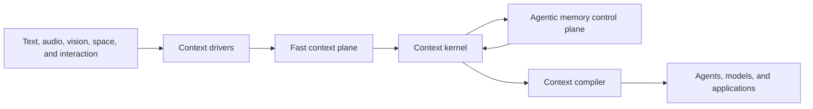

# Context OS direction

SenseMem is a unified Context & Memory layer for agents, across devices, modalities, and models.
This page explores the long-term architecture for that role under the name **Context OS**.
It does not claim that every behavior below is implemented or public.
[Design principles](design-principles.md#smarter--swifter--stronger) defines the Smarter / Swifter /
Stronger product criteria; [architecture](architecture.md) owns current implementation invariants,
and the API references own current contracts.

Scheduling remains host authority: `capture()` does not schedule `settle()`, and configuring a
consolidator does not start a loop. A host may call `consolidate()` explicitly or enable the
[serving-process timer](configuration.md#running-the-loop-inside-a-server-process). That timer
does not add a network control-plane route or settle captured records.

> Direction: receive context from digital interactions and the physical world, form and maintain
> memory across time, and compile evidence-backed context for the agent's current task.

Sources include chatbots, coding agents, smart glasses, phones, and robots. Physical-world context
retains time, place, identity, and original media; digital interactions use the same lifecycle.
Agentic management proposes how memory should evolve. Context OS names the deeper lifecycle and
scheduling architecture behind this unified layer.

## Why an operating system

A memory runtime stores and retrieves records. A Context OS additionally owns:

- the lifecycle from transient observation to durable, formed, consolidated, archived, or deleted
  context;
- scheduling between latency-sensitive work and slower reasoning;
- evidence, version, permission, resource, and privacy policy;
- selection and compilation of context for a downstream task; and
- stable interfaces through which applications, models, and agents consume those capabilities.

The term does not mean that SenseMem is a host operating system or a general AgentOS. The host
agent still owns user goals, planning, tool selection, and action. SenseMem owns the narrower
goal of managing context well.

## Product boundary



| Layer | Responsibility |
| --- | --- |
| Context drivers | Normalize device, provider, and application events into immutable observations and explicit finality. |
| Fast context plane | Maintain changing working context, speculative recall, and low-latency durable capture. |
| Context kernel | Enforce evidence, identity, time, space, version, durability, and permission invariants. |
| Agentic memory control plane | Deliberate over longer histories and propose reinforcement, consolidation, correction, and forgetting. |
| Context compiler | Select a task-ready context bundle within latency, size, freshness, evidence, and privacy budgets. |
| SDK, REST, and MCP | Present different views of the same kernel to developers, services, and agents. |

Governance crosses every layer. Model output is a proposal at a trust boundary, never authority to
rewrite evidence or bypass policy.

SenseMem owns the lifecycle and meaning of context. It does not own camera or microphone drivers,
VAD, SLAM, general task planning, GPU scheduling, or the final action taken by an agent.

## Consumers and authority

Developers and agents both consume SenseMem, but they are not the same kind of consumer. A human
whose life is observed is also a first-class participant even when they never call an API.

| Participant | Role | Authority |
| --- | --- | --- |
| Developer or operator | Select models, connect sensors, set policy, diagnose, re-ingest data, and recover the runtime. | Full instance administration inside the host's security boundary. |
| Agent | Request context, add explicit observations, and report outcomes or feedback. | Bounded capabilities granted by the host. |
| Human data subject | Own consent, identity naming, correction, export, retention, and physical deletion decisions. | Final authority over sensitive personal context. |

An agent must not gain identity enrollment, irreversible merge, or physical deletion authority
merely because it can call ordinary recall tools. The host chooses whether to expose sensitive
operations and when human confirmation is required.

All six of the data subject's authorities are named calls, and each is an act a host performs on
their behalf rather than a setting a model can reach:

| Authority | Call | Reversible by |
| --- | --- | --- |
| Consent | `record_consent(identity_id, state, note=...)`, read back by `consent(identity_id)` | `rollback()` of its `CONSENT` row, or a later statement that supersedes it |
| Identity naming | `register_identity` | `rollback()` of its `IDENTIFY` row |
| Correction | `rollback(operation_id)`, and `unlink_identity` for a wrong cross-modal merge | Itself: `rollback()` of the split's `CORRECT` row re-merges |
| Export | `export(identity_id=...)` or `export(memory_ids=...)` | Nothing to reverse; it reads only |
| Retention | the declarative `retention` policy, applied by `apply_retention(dry_run=False)` | Nothing: it is physical deletion, and `dry_run=True` is the review step |
| Physical deletion | `delete(memory_id)` and `forget_identity(identity_id)` | Nothing, by definition |

Consent is an assertion in the same family as naming -- an identity-bound, versioned claim
recorded as `USER_STATEMENT` -- and it is the one claim no backend may propose: a `CONSENT`
operation reaching the kernel from a model is refused as `unauthorized`, exactly as a proposed
`MERGE` is, because a model that could infer consent could manufacture permission to process a
person. `consent` is a reserved predicate for the same reason: ordinary formation never passes
through the control plane, so a model's typed proposal carrying it is stored unbound -- an
inference about a subject rather than a statement by a person -- and binds to nobody. Withheld or withdrawn consent restrains the kernel from the next observation on: no new
face or voice exemplar is enrolled for that person, no cross-modal merge binds their voice to
their face, and `compile()` leaves them out of the bundle's actors with a `CONSENT_WITHHELD`
unknown. Recognition against existing exemplars and retrieval of the source memories remain
available. These are runtime policy effects, not a complete consent or access-control workflow;
`forget_identity` is the separate operation that erases the stored template.

One authority does not compose cleanly with another person's, and the honest place to say so is
here: a recording two people share is held about both, so it appears in both their exports, each
carrying the other's observations. Answering one subject with less than is held would be a false
answer, and redacting the other person out of shared evidence would mean rewriting an
observation, which is the invariant this system does not break. Deciding what a host may then do
with that export is the host's, not the kernel's.

## Time scale is not memory type

Fast and slow memory describe processing policy. Semantic, episodic, and procedural memory describe
cognitive role. They remain orthogonal and use one authoritative evidence model.

| Plane | Latency concern | State | Typical work |
| --- | --- | --- | --- |
| Working context | Current interaction deadline | Volatile | Coalesce partial text, audio, and frames; run speculative recall; discard abandoned turns. |
| Fast durable context | Capture acknowledgement | Authoritative observation | Persist final content, provenance, event time, and media identity without waiting for slow reasoning. |
| Search-ready context | Time to useful recall | Durable projection | Transcribe, embed, index, and expose readiness. |
| Slow memory | Intelligence and cost budget | Derived, evidence-linked state | Form entities and events, resolve conflicts, consolidate patterns, update traits, and manage retention. |

These are lifecycle milestones, not a requirement for four databases or one public status enum.
SQLite remains authoritative and Zvec remains a rebuildable projection.

### Fast context plane

The current streaming contract already distinguishes speculative `UPDATE`, durable `FINAL`, and
discarded `CANCEL` events. The target fast path extends that distinction to acknowledgement:

1. Validate and materialize a final observation.
2. Commit its raw evidence and durable follow-up work in SQLite.
3. Acknowledge capture.
4. Perform model-dependent enrichment and indexing outside the capture deadline.

The current `add()` contract remains the strong path: a successful return means the record is
searchable through its completed model and index work. The fast path is explicit rather than a
silent weakening of `add()`: `capture()` acknowledges after the SQLite commit and `settle()` runs
the deferred model stages, with the contract in
[the Python SDK reference](api/python-sdk.md#memory-operations).

No universal millisecond promise is meaningful. Latency objectives must name the hardware,
payload, modality, model placement, warm or cold state, percentile, and required readiness level.
At minimum, measure capture acknowledgement, time to searchable, warm search, speculative
time-to-first-hit, and slow-formation lag separately.

### Agentic memory control plane

Slow memory requires intelligence because retention cannot be reduced to recency or retrieval
count. Its loop is bounded and proposal-driven:

```text
durable trigger
-> gather a bounded evidence set
-> identify contradiction, redundancy, pattern, or utility
-> propose memory operations
-> validate policy and kernel invariants
-> commit atomically
-> record outcomes for evaluation and rollback
```

Useful triggers include new independent evidence, explicit feedback, a contradiction, repeated
query failure, memory pressure, and an operator-approved idle or charging window. A periodic timer
alone is not evidence that work is useful.

The first implementation should be one memory-management loop, not a swarm of specialized agents.
The reasoning backend may change, but the proposal vocabulary and kernel validation remain stable.

| Intent | Kernel semantics |
| --- | --- |
| Reinforce | Record independent supporting evidence or explicit utility feedback. Automatic answer reinforcement counts backend-declared hits only on non-abstained results; this does not verify factual support. |
| Consolidate | Create a higher-level derived memory with explicit evidence links; preserve source observations. |
| Merge | Unify compatible derived identity or meaning while retaining reversible lineage. Kernel-initiated from corroborated cross-modal evidence, not backend vocabulary: a proposed merge is refused. |
| Update | Add a new valid and transaction-time version that supersedes prior state; do not overwrite history. Realized as consolidate into an existing lineage. |
| Correct or split | Reverse a bad inference, identity merge, or consolidation without manufacturing new source evidence. |
| Forget | Change retrieval visibility or retention state under policy; do not equate it with physical deletion. |

Every proposal names its evidence, model and recipe, expected effect, and idempotency identity. The
kernel rejects unsupported, unauthorized, internally inconsistent, or stale proposals. The loop
never writes SQLite directly. All four rejections are enforced, not aspirational: a proposal may
name targets only inside the window the kernel gathered for it, must be eligible in every target
it names or be refused whole, and is re-checked inside the apply transaction so a target that was
forgotten, corrected, or deleted since validation is refused as stale rather than half-applied.

`FormationBackend` is the seed of this plane: it proposes typed state from one committed
observation while the kernel validates and persists it. `ConsolidationBackend` is the plane itself:
`consolidate()` gathers a bounded, active evidence set, the backend proposes `MemoryOperation`
values for reinforce, consolidate, correct, forget, and evidence-backed identify, and the kernel validates
each one, commits it with its log row, and can `rollback()` it. Merge and consent are never
accepted as model proposals: a cross-modal identity merge is committed by the kernel from co-occurrence evidence it
counted itself, with its own reversible log row, and a proposed `MERGE` is rejected as
`unauthorized`. `consolidation_candidates()` is the
durable trigger in front of that loop: it derives due work -- new independent evidence, a lineage
that contradicts itself, a record confirmed since it was last weighed, a question recall answered
with nothing, a store over its declared budget, an operator-approved idle window -- from committed
state, so deliberation is scheduled on evidence rather than on a clock. `consolidate_pending()` is the loop
itself, running those two halves within `max_rounds` and reporting what the run cost and yielded, and
`apply(operation)` is the same kernel validation for an operation a host supplies, which makes
replay of a logged sequence a public path. Neither a clock nor a candidate that always comes back
is evidence that work is useful, so each pass records that it weighed its evidence set even when
it yielded nothing. The Python SDK reference owns the exact contract; the reasoning backend can
change without changing that vocabulary.

## Forgetting is three operations

| Form | Effect | Authority |
| --- | --- | --- |
| Cognitive forgetting | Exclude or downrank context in ordinary recall while retaining auditability and recovery. | Policy may act automatically within configured bounds. |
| Consolidation forgetting | Prefer a compact derived memory and move detailed evidence out of the normal recall path. | The memory loop may propose it; the kernel preserves lineage. |
| Physical forgetting | Remove live records and unreferenced media; operation history and storage remnants can retain related information. | Explicit human or deterministic retention policy. |

Decay is cognitive ranking only, and `forget()` is cognitive forgetting: a forgotten record leaves
recall, stays readable through `get()` and `list()` with its `forgotten_at`, and returns through
`rollback()`. Consolidation forgetting is a control-plane proposal over evidence lineage: a
`CONSOLIDATE` may name sources of its own to retire, they leave recall in the same transaction that
creates the derived record, the evidence links stay, and the log row carries them as
`forgotten_ids` so the two halves reverse together. Physical forgetting remains `delete()`,
`forget_identity()`, and the declared retention policy `apply_retention()` runs under host
authority, and is not a proposal intent. Retention is the deterministic half of the same
authority: a policy names maximum ages for raw media, for records cognitive forgetting already
moved out of recall, and for capture-queue rows whose failures have aged out, and every deletion
it performs goes through `delete()`, so the completeness rules above hold unchanged. An unset age
is not a zero-day policy; it does nothing. Retention work must keep
these meanings separate in APIs, telemetry, and user-facing controls, and the operation log already
does: `delete()` leaves no row, cognitive forgetting is a `FORGET` row over `target_ids`, and
consolidation forgetting is a `CONSOLIDATE` row carrying `forgotten_ids`. Erasing a *person* is the
one physical forgetting that does leave a row, because a data subject's request has to be
auditable: it is a `FORGET` row over an `IdentityChange` rather than over memory IDs, it carries
only the identity, its aliases, and the naming assertions it deleted, and `rollback()` refuses it.
Which of the two a `FORGET` row names is the discriminator: a row over records is reversible, a row
over a person is not.

## Context compiler

Retrieval returns candidate evidence. The Context OS becomes useful to downstream output when it
can compile that evidence into a bounded context view for a particular task.

A context compilation request supplies a goal or query plus constraints such as maximum latency,
text or media budget, freshness, allowed sensitivity, spatial scope, and minimum evidence quality.
The resulting bundle may contain:

- current actors, relationships, and scene state, each in its own bundle section, with a named
  actor's identity edge resolved through the same read path whether or not the naming assertion
  itself ranked into the bundle;
- relevant episodic, semantic, and procedural memories;
- affect cues separated from longer-horizon traits, each cue carrying its basis, cue
  modality, and confidence; see [affective memory](affective-memory.md) for why a cue is
  never reconciled into a single current feeling;
- temporal and spatial bounds, both metric frames and symbolic places;
- conflicts, uncertainty, and explicit unknowns; and
- provenance needed to inspect or correct the result.

The compiler selects and structures context; it does not choose the agent's final answer or action.
`ask()` may remain a convenient grounded-generation surface, but it is not the operating-system
boundary. `compile()` is implemented in Python, REST, MCP, and the CLI; see
[context compilation](context-compilation.md) for the contract and
[REST](api/rest.md#endpoints) and [MCP](api/mcp.md#tools) for the transport forms.

The first compiler should remain request-response and reuse the existing retrieval kernel. Push
subscriptions, proactive interruption, and shared multi-agent working sets wait for a demonstrated
application requirement.

## Models, modalities, and plugins

Model independence means replacement behind a declared capability contract. It does not mean that
durable representation spaces can be swapped in an existing directory. Embedding model, dimension,
input recipe, identity space, and formation recipe have explicit identities. A changed embedding
space requires re-ingestion into a fresh directory.

New modalities enter through the smallest adapter that can normalize them to immutable content,
declared capability, event time, provenance, and optional spatial context. Accepting a file format
alone is not omni-modal memory; cross-modal evidence must remain connected to the same event,
person, relationship, place, and source.

Model capabilities are extensible. Storage authority, transaction ordering, evidence semantics,
and lifecycle validation are kernel policy rather than storage plugins. A global registry, live
backend swap, external queue, or alternate database is added only for a measured requirement that
the embedded runtime cannot satisfy.

## Interfaces

The Python SDK is the full developer and device integration surface. REST exposes process-safe
application operations. MCP exposes a small agent-appropriate capability view rather than mirroring
every administrative method.

The three surfaces carry different authority, not different capability. The SDK is the full
surface: every public `Memory` operation, including the control plane, is reachable because the
SDK runs inside the process that owns the memory. REST is a network-facing subset of that same
process: the ordinary application path -- add, search, ask, compile, and the fast-capture plane
(`capture`, `settle`, `pending_captures`) -- is always on, because it is an operation on the
caller's own records rather than authority over a person, while identity administration (naming,
reading, unlinking, and erasing a person) and embodied analysis (`perceive`) are opt-in
behind `create_app`'s `identity_operations` and `embodied_operations`, both defaulting to off,
because a caller reaching REST over a network is not automatically the memory's owner. MCP is the
agent view of the same process and carries its own `identity_operations` switch with the same
name and the same default-on-for-a-trusted-agent-host reasoning; a host that wants REST and MCP to
grant the same agent the same authority sets both switches the same way. Neither transport ever
reaches the control plane -- `consolidation_candidates`, `consolidate`, `forget`, `rollback`, and
`operations` stay SDK-only regardless of any switch. What runs the loop for a deployment that only
speaks REST or MCP is the serving process itself: the `deliberate_every` both `create_app` and
`build_mcp_server` take runs `consolidate_pending()` on an interval inside the server lifespan, which is
the only place that can, because one physical `data_dir` has one live owner and the
`QUERY_FAILURE` rows those routes and tools write are readable nowhere else. See
[the configuration reference](configuration.md#running-the-loop-inside-a-server-process).

The compiler is that view's centre. `POST /v1/context` and the `compile_context` MCP tool return a
budgeted bundle with provenance, and `GET /healthz` and the MCP server instructions advertise the
configured modalities and backends so an agent does not discover them through failure. Both
resolve nothing and write no memory beyond the same query-audio transcript cache `search` writes,
which is why neither is annotated read-only. A compilation that finds nothing does record that,
as the bounded signal the control plane's `QUERY_FAILURE` trigger reads, which changes no
evidence and no memory.
Answering stays available as a convenience rather than the operating-system boundary.

High-rate sensor streams stay on the embedded SDK boundary. Agents operate on completed
observations or stable asset identifiers. Cognitive forgetting, consolidation, operation rollback,
and applying a retention policy stay with the process that owns the memory; identity
naming, merge reversal, and erasure are separate trusted tools that no ordinary recall or compile
call grants. A host can withhold identity tools, perception, and explicit record-write tools
through the MCP group switches; recall tools can still persist caches and failure signals.

The three data-subject rights that are not naming -- recording consent, exporting a subject, and
applying retention -- reach REST behind the same `identity_operations` switch and reach MCP not at
all. Consent is a statement its subject makes, so an agent that could record one could manufacture
permission; an export is everything held about a person and retention physically deletes, so both
are authority over a person's whole record rather than a request about the caller's own. The
export route is the one place a control-plane value crosses a transport, because the right of
access covers how the data was processed and not only what is held; it is read-only, and no route
proposes, applies, or reverses an operation.

All interfaces call one owner of one physical `data_dir`. Supporting several agents against that
owner does not introduce logical account or request scope into the memory contract. A hosted
multi-tenant product remains a deployment layer with physically isolated memory domains.

## Invariants that survive the evolution

- Raw observations are evidence and are never silently rewritten into model interpretations.
- SQLite commits authoritative state before any derived index is acknowledged.
- Every derived memory retains evidence, model, recipe, and version lineage.
- Model reasoning proposes; deterministic kernel policy authorizes and commits.
- Slow work never blocks the explicit fast-capture acknowledgement path.
- Search hydration and context compilation reapply authoritative visibility and scope.
- An agent cannot convert ordinary tool access into sensitive administrative authority.
- Physical deletion is distinguishable from ranking decay and consolidation.
- One physical data directory remains one live memory domain.

## Product measurements

`SOTA` is a benchmark result, not an architecture property. The product objective is the best
context utility under the target device's latency, resource, and privacy constraints.

| Outcome | Required measurements |
| --- | --- |
| Real-time behavior | Capture acknowledgement and search p50, p95, and p99; time to searchable; speculative first-hit latency; CPU, memory, and disk. |
| Context utility | Downstream task success against no-memory, full-context, and retrieval-only baselines; useful evidence per token and per millisecond. |
| Embodied quality | Multimodal, temporal, and spatial recall; identity false merge and fragmentation; affect attribution and trait false positives. |
| Slow-loop quality | Consolidation precision, contradiction recovery, false retirement, rollback success, model cost, and formation lag. `sensemem-bench control-plane` measures the first five; formation lag is still unmeasured. |
| Trust | Crash recovery, replay determinism, provenance coverage, permission enforcement, and deletion completeness. |
| Developer and agent experience | Time to first memory, integration code, tool-call success, context size, and correction effort. |

The existing [benchmark harness](benchmarking.md) measures many retrieval and task-quality axes.
Context OS claims additionally require end-to-end agent scenarios and measurements on named
deployment hardware. External results guide hypotheses; only reproducible SenseMem runs select
defaults or justify superiority claims.

## Evolution gates

These gates separate implemented mechanisms from the evidence still needed to choose defaults.
They are design criteria, not a release schedule.

| Gate | Implemented mechanism | Evidence still required |
| --- | --- | --- |
| Capture latency | Explicit `capture`, `settle`, readiness inspection, and final-boundary reducers | Named-hardware acknowledgement, time-to-searchable, and speculative first-hit measurements |
| Memory management | Bounded proposals, candidate scheduling, logged operations, replay, outcomes, and rollback | Application-scenario quality, privacy, false-retirement, and cost measurements |
| Context utility | Evidence closure, budgets, conflicts, unknowns, actors, excerpts, and certificates | Paired downstream-task comparisons with no-memory, full-context, and retrieval baselines |
| Interfaces | One kernel behind Python, REST, MCP, and CLI, with explicit authority switches | Integration and usability evidence for each intended host |
| Affective context | Sourced affect cues and corroborated trait visibility | Per-modality calibration and interaction quality under the [affect roadmap](affective-memory.md) |

The [evaluation harness](benchmarking.md) can measure many of these axes, including capture
latency with `--ingest capture` and downstream utility with the `compile` arm. It does not exercise
continuous sensor ingestion or establish real-world companion quality. Runtime mechanisms alone
do not close those measurement gates.
