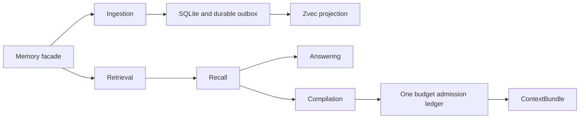

# Maintaining SenseMem

Start with the product contracts, then follow one complete operation. Reading every adapter
or benchmark is unnecessary for understanding the embedded runtime.

## Reading route

1. Read [concepts](concepts.md) and [typed memory](typed-memory.md): one physical directory owns
   observations, derived assertions, identities, evidence and index projections.
2. Read `Memory.__init__` in `src/sensemem/memory.py` as the dependency graph. Public methods
   validate and forward; the named kernel plane owns each operation.
3. Follow `Ingestion` through shared document preparation, SQLite commit and `Projection.drain`.
   Then follow `Retrieval` through candidate selection and authoritative SQLite hydration.
4. Follow `Recall`, then its two consumers, `Answering` and `Compilation`. Answer generation and
   context compilation share bounded recall without depending on each other.
5. Read the contracts and failure tests for the behavior being changed. Open a provider or
   protocol adapter only when that boundary is relevant.

## Names with different jobs

| Name | Meaning |
| --- | --- |
| `MemoryCategory` | Storage/retrieval category: episodic, semantic or procedural. Wire fields retain `memory_type`. |
| `RecordKind` | Semantic role: observation, entity, relation, state, event, affect, trait or response policy. |
| `RecordSemantics` | Persisted meaning, evidence, authority and temporal validity of one record. |
| `MemorySettings` | Value-only runtime policy; passed as `settings=` to object construction. |
| `MemoryPlugins` | Already constructed capability objects owned by one runtime. |
| `MemorySpec` | Declarative configuration; each backend field accepts a provider or registered factory. |
| `build_memory_composition` | Validates a specification and creates owned adapters without opening storage. |
| `QueryRepresentationPlan` | Text and embedding representations for one retrieval query. |
| `RecallProgram` | Bounded corpus reads for answering or compilation. |

The recall helpers use the same domain name: `fallback_recall_program` constructs the default,
`parse_recall_program` validates planner output, and `execute_recall_program` runs the bounded reads.

## Name the operation and its boundary

Names identify the effect or returned value at a call site. `build_memory_composition` creates
owned adapters, `materialize_content` persists and leases media, `run_in_worker` crosses a thread
boundary, and `read_co_derived_event_ids` reads SQLite. Parsing helpers name the value they decode;
JSON schema builders carry a `_schema` suffix. Conventional resource operations such as `get`,
`list`, and `close` remain concise when the receiver already identifies the resource.

`AgentRunner.run_async` makes asynchronous execution explicit. A proof's
`structurally_independent_of` comparison describes its structural limit; evidence policy is
applied separately when a bundle validates its delivered certificates.

Check consumers before deleting a callable: follow imports and re-exports, console entry points,
decorators, protocols, framework callbacks and browser registrations as well as ordinary calls.
Public SDK operations and protocol implementations remain contracts when applications are their
consumers. Remove unreachable implementation code and its obsolete tests together. Do not retain
an unused implementation behind a compatibility alias.

## Where a change belongs

| Change | Owner |
| --- | --- |
| Public values | Small top-level domain modules; re-export supported names from `sensemem`. |
| Evidence support or state precedence | Pure `evidence_policy.py`; storage, compiler and delivery boundaries use the same rule. |
| Add and settle preparation | `kernel/ingestion.py`; its shared preparation owns media derivation and embedding inputs. |
| Media materialization | `Materializer.materialize_content` validates, persists and leases input; `lease_model_input` owns the application computation's lease. |
| Embedding input construction | `Embedding.with_transcript_fallback`, `prepare_document`, `route_input` and `build_retrieval_inputs` name distinct steps before vector creation. |
| Application ingestion stages | `IngestionStages.process_memory` appends labelled interpretations; the ingestion plane owns persistence. |
| Recall planning and reads | `kernel/recall.py`; generation stays in `answering.py`. |
| Context priorities | `context_selection.py`; selectors return priorities and diversity, without budget simulation. |
| Complete/partial delivery and budgets | `_Admission` in `context.py`; rendering stays in `context_rendering.py`. |
| Naming and refreshed speech | Kernel prepares a `NamingProjection`; SQLite verifies and commits it atomically. |
| Model requests | `OpenAIEmbedder`, `OpenAITranscriber` or `OpenAICompletion`; pure prompts stay in `prompts/`. |
| Response shape | `api/responses.py`, shared by REST, MCP and CLI. Request policy stays with each protocol. |
| Declarative construction | `configuration.py`; validate a `MemorySpec` once and build typed providers directly. |
| Startup reconciliation | `Recovery.reconcile_store` checks recipes, updates metadata and queues a derived-index rebuild. |
| Worker admission | `Execution.run_in_worker` dispatches synchronous calls through instance limits onto process-owned executors. |
| Identity telemetry | Speech and vision open their own stages and call `record_identity_yield`; `Traced` owns only shared span mechanics. |
| Live example composition | `examples/live/app.py`'s `LiveRuntime` owns memory, capture lifecycle and provider clients. |

The optional `resolve_co_derived_event_ids` callback is an explicit storage dependency of context
compilation. The kernel supplies `_read_co_derived_event_ids`; selection invokes it only for
admitted affect cues and before the deadline. Its name distinguishes the resolver from the
resolved mapping and keeps the read bounded by delivered items.

## Benchmark reading route

`benchmarks/eval.py` owns CLI and run orchestration. `eval_options.py` contains immutable values;
clients, stores, caches, semaphores and observers remain explicit arguments. `eval_inputs.py`
owns corpus boundaries and cache identities, `eval_ingest.py` owns checkpointed ingestion,
`eval_answers.py` owns question execution, `eval_runner.py` owns isolated units and replay,
`eval_samples.py` owns observed/cached sample conversion, and `eval_report.py` owns reports.
`IngestRunState` belongs to one run, including concurrent units; there are no process-global
failure flags or deliberation counters. Runner v28 invalidates older response-cache identities.
Official scorers and pinned prompt provenance remain in their existing components.

Shared artifact helpers in `artifact_io.py` use `encode_json_bytes`, `encode_jsonl_bytes` and
`replace_artifact_files`. Each target replacement is atomic; callers own multi-file receipt and
fingerprint validation.

## Verify a change

Use the focused tests for its owner and direct callers, plus contract tests for public changes.
Naming tests must prove model failures preserve the entire transaction and model execution
holds no SQLite write transaction. Retrieval tests cover stale index IDs and rebuild without
re-embedding. Compiler tests cover complete evidence, conflicts, consent, partial deliveries and
budget accounting. Protocol tests verify one response shape without leaking local asset paths.
Follow [Contributing](../CONTRIBUTING.md) for required gates and avoid the full suite unless
explicitly requested. Model behavior changes additionally need the [quality gate](model-quality.md).
