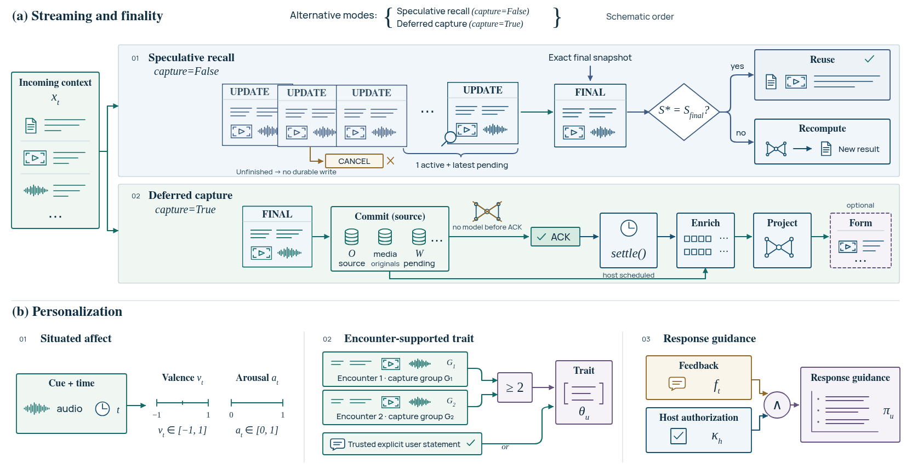

# Omni streaming and interaction memory

Connect continuous input to durable memory without storing every partial hypothesis.
SenseMem supports speculative recall during a turn and an explicit commit when the observation
is complete. `StreamEvent` defines that lifecycle:

1. An `UPDATE` is a complete current snapshot used only for speculative search.
2. A `FINAL` is a completed observation eligible for exactly one durable write.
3. A `CANCEL` or end-of-stream before finality writes nothing.

`AsyncAudioStream` and `AsyncVisionStream` map canonical capture values onto that contract.

This page owns those lifecycle boundaries. Sensor capture, stream reconnection, provider packet
decoding, pixel conversion, frame selection, and turn detection remain application or adapter
work: the application decides when an observation is complete and normalizes it to `ContentInput`.



*From the SenseMem technical report, Figure 3. Panel (a) shows the alternative speculative-recall
and deferred-capture modes: unfinished input stays transient, while finalized capture commits
before acknowledgement and host-scheduled settlement. Panel (b) shows the downstream
[affective-memory](affective-memory.md) rules: inferred traits need independent capture groups,
and response guidance requires feedback and host authorization.*

## Choose the smallest stream API

| Need | API |
| --- | --- |
| Lazily add completed independent observations | `Memory.add_stream()` or `AsyncMemory.add_stream()` |
| Deliver an answer while the model is still writing it | `Memory.ask_stream()` or `AsyncMemory.ask_stream()` |
| Acknowledge completed observations without waiting for models | `Memory.capture()` with `Memory.settle()`, or any stream API with `capture=True` |
| Search while one query snapshot is changing | `AsyncOmniPrefetch` |
| Associate speculative snapshots with final commits | `AsyncCaptureStream` |
| Normalize PCM, VAD, and ASR state | `AsyncAudioStream` |
| Normalize encoded frames and visual descriptions | `AsyncVisionStream` |

Use `add_stream()` unless the application benefits from speculative recall. Use the capture
reducers only when explicit finality is available. Every reducer takes an `AsyncMemory`, written
`async_memory` below; the synchronous snippets assume an open `memory` plus already-read immutable
media bytes.

Partial query snapshots must be immutable: prefetch rejects `Path` atoms, whose bytes could
change while a search is running. Read a capture frame into `Blob` or use an existing `AssetRef`.
Completed durable writes still accept ordinary local `Path` content through the SDK.

The capture APIs stream observations into memory. `ask_stream()` streams an answer out; its
delivery contract is in the [memory API](api/python-memory.md#ask_stream).

## Add completed observations

`Memory.add_stream()` consumes a lazy iterable of `ContentInput` or `StreamInput` values. Each item
uses the ordinary `add()` path and is durable and searchable before the next item is requested. The
stream is not one transaction: a later source or item failure leaves the committed prefix intact.

Use `StreamInput` when observations need independent event time, metadata, memory type, context,
transcript, or visual description:

```python
from datetime import datetime, timedelta, timezone

from sensemem import Blob, MemoryType, StreamInput

started = datetime(2026, 8, 31, 9, tzinfo=timezone.utc)
observation = StreamInput(
    (
        "The user is looking for the red toolbox.",
        Blob(frame_bytes, "image/png", "frame.png"),
        Blob(audio_bytes, "audio/wav", "speech.wav"),
    ),
    occurred_at=started,
    occurred_end=started + timedelta(seconds=2),
    metadata={"source": "companion_robot", "sequence": 17},
    memory_type=MemoryType.EPISODIC,
)

for source_record in memory.add_stream((observation,)):
    print(source_record.id)
```

The async form accepts an `AsyncIterable` and yields with `async for`. Both forms preserve source
backpressure and identify a failing item as zero-based `contents[index]` in the public error.

Mutable ASR hypotheses, incomplete media, and repeatedly overwritten file paths are not completed
observations. Keep them out of durable `add_stream()` input.

## Fast capture

Use `capture()` instead of `add()` when the observation is final but the caller cannot wait for
transcription, embedding, indexing, and formation — a device that must acknowledge a burst of
finals, or a turn loop that would otherwise block on the slowest model. `capture()` returns after
the SQLite commit; the record becomes searchable when the host calls `settle()`.

```python
for observation in burst:
    memory.capture(observation)

while memory.settle(limit=32):
    pass
```

Continue while `settle()` returns completed work. Rows at the retry ceiling remain queued;
inspect their `attempts`, `last_error`, and `awaiting` fields with `pending_captures()`.
`awaiting="enrichment"` means vectors are pending; `awaiting="formation"` means the record is
searchable and typed formation remains. After fixing a failure, retry that record explicitly with
`settle(memory_ids=...)`, which bypasses its attempt ceiling. Claims prevent duplicate work on
one record while disjoint records can settle concurrently.

Use `add()` when the caller needs searchability on return. With `capture()`, schedule
`settle()` explicitly; retrieval and shutdown leave deferred work queued. See
[memory operations](api/python-memory.md) for failure semantics.

## Prefetch a changing query

`AsyncOmniPrefetch` wraps an open `AsyncMemory` and overlaps retrieval with an unfinished turn
without storing its partial input. Every submission is the complete current query snapshot, not a
delta:

```python
from sensemem import AsyncOmniPrefetch

prefetch = AsyncOmniPrefetch(async_memory, limit=8)
prefetch.submit((partial_text, latest_frame, current_audio_window))
prefetch.submit((newer_text, latest_frame, current_audio_window))

result = await prefetch.finalize((final_text, final_frame, final_audio_window))
hits = result.hits
```

Only one search runs at a time. While it runs, a newer submission replaces the snapshot that has
not started yet. `latest` returns the newest completed `PrefetchResult` without waiting. Results
contain only `hits`; `submit` returns `None`.

`finalize` returns only a result for the exact final snapshot. It reuses an already completed
result when the values match and that search succeeded; otherwise it waits for a search of the
final snapshot. It then closes that per-turn prefetcher.

Snapshots accept immutable text, `Blob`, and `AssetRef` values. Raw `Path` values are rejected
because the file may change after submission. If a turn is abandoned, `await prefetch.close()`
drops queued work and waits for any search already dispatched to the SDK's worker pool.
Cancelling that task would not stop its synchronous model or index call, so the helper drains it.

Prefetch never stores or reinforces a snapshot. Call `reinforce` only after the application has
observed positive use or feedback.

## Capture-event reducer

`AsyncCaptureStream` provides the lifecycle that raw `add_stream()` lacks. Every `StreamEvent`
carries a `stream_id` (`"default"` when omitted), so interleaved microphones, cameras, or sessions
keep independent speculative state. The same ID comes back on the resulting `StreamCommit`.

| Phase | Payload | Retrieval | Durable write |
| --- | --- | --- | --- |
| `UPDATE` | Complete current immutable `ContentInput` snapshot | Speculative and coalesced | Never |
| `FINAL` | Exact final `ContentInput` or `StreamInput` | Exact-final confirmation | Once |
| `CANCEL` | None | That stream alone is discarded and drained | Never |
| EOF before `FINAL` | — | Every open stream is discarded and drained | Never |

```python
from sensemem import AsyncCaptureStream, StreamEvent, StreamPhase


async def camera_events():
    yield StreamEvent(StreamPhase.UPDATE, left_frame, stream_id="camera-left")
    yield StreamEvent(StreamPhase.UPDATE, right_frame, stream_id="camera-right")
    yield StreamEvent(StreamPhase.FINAL, left_clip, stream_id="camera-left")
    yield StreamEvent(StreamPhase.FINAL, right_clip, stream_id="camera-right")


capture = AsyncCaptureStream(async_memory, limit=8)
async for commit in capture.consume(camera_events()):
    print(commit.stream_id, commit.record.id, commit.prefetch, commit.retrieval_error)
```

`max_streams` defaults to 32 and bounds the active prefetch workers. One search runs at a time per
ID; different IDs may search concurrently. A final or cancel boundary frees that ID. The two packet
reducers additionally accept `context=`, either a fixed `ObservationContext` or a callable read once
per closed observation, because a capture stream outlives the observations it commits.

`AsyncCaptureStream`, `AsyncAudioStream`, `AsyncVisionStream`, and `add_stream()` all accept
`capture=True`, which commits each final through `capture()` instead of `add()`. That is the
complete path from continuous observation to acknowledgement: a `FINAL` acknowledged after the
SQLite commit, and enrichment deferred to `settle()`. In capture mode, automatic `UPDATE` and
`FINAL` retrieval is skipped so query models cannot delay the acknowledgement; use a separate
`AsyncOmniPrefetch` for speculative retrieval. Every `StreamCommit` then reports
`pending_settlement=True`, `prefetch=None`, and `retrieval_error=None`. New records stay out of
`search()` until settlement. The flag identifies capture mode; an idempotent capture of an existing
record preserves its readiness. Use `pending_captures()` to inspect actual outstanding work.
A `StreamInput` transcript or description is folded in at capture time,
so capture and add produce the same content-addressed record. By default, finals use `add()`
and yield searchable records.

```python
audio = AsyncAudioStream(async_memory, limit=8, capture=True)
async for commit in audio.consume(audio_packets()):
    assert commit.pending_settlement

while await async_memory.settle(limit=32):
    pass
```

If final retrieval fails, the observation still commits and `StreamCommit.retrieval_error` carries
a stable public error code, or `retrieval_failed` for an unclassified exception. Cancellation before
the final write starts stores nothing. Once that write starts, cancellation waits for the commit and
then propagates, so no worker writes after a cancelled task has returned.

`AsyncAudioStream` and `AsyncVisionStream` accept a `memory_type` and `context`. The context may be
one fixed `ObservationContext` for a static sensor or a zero-argument sampler for a moving sensor;
the sampler is read once when each observation closes, so its metric pose or symbolic `place_id`
belongs to that durable observation. Speculative updates do not persist the sampled context.

## Native audio protocol

`AsyncAudioStream` is the canonical speech-capture adapter. It accepts four immutable values:

- `PCMChunk`: interleaved WAV-compatible linear PCM plus sample rate, channels, sample width,
  timestamp, and `stream_id`;
- `VADPacket`: the complete current voice-active state;
- `ASRPartial`: the complete current ASR hypothesis, not a provider delta;
- `AcousticBoundary`: explicit `START`, `END`, or `CANCEL` finality.

```python
from sensemem import (
    ASRPartial,
    AcousticBoundary,
    AsyncAudioStream,
    AudioBoundary,
    PCMChunk,
    VADPacket,
)


async def audio_packets():
    yield VADPacket(True, stream_id="headset")
    yield PCMChunk(first_pcm, sample_rate_hz=16_000, stream_id="headset")
    yield ASRPartial("where is the red", stream_id="headset")
    yield PCMChunk(second_pcm, sample_rate_hz=16_000, stream_id="headset")
    yield ASRPartial("where is the red toolbox", stream_id="headset")
    yield AcousticBoundary(AudioBoundary.END, stream_id="headset")


audio = AsyncAudioStream(async_memory, limit=8)
async for commit in audio.consume(audio_packets()):
    print(commit.stream_id, commit.record.id)
```

PCM accumulates independently per ID and is wrapped in a standard WAV container. A native-audio
embedding backend receives changing audio snapshots directly. A text-only backend receives ASR
partials for speculative retrieval; the final hypothesis binds to the WAV through
`StreamInput.transcript`, stays in the durable record, and drives text embedding. Without an
external hypothesis, the configured transcription backend is the fallback. With neither route the
operation fails rather than dropping audio.

`VADPacket(active=False)` and `AudioBoundary.END` finalize; `CANCEL` and incomplete EOF never write.
A PCM format change inside a segment, or a buffer beyond the local asset limit, fails validation.
Normalize vendor VAD and ASR payloads to these four values instead of teaching the kernel provider
packet schemas.

## Native vision protocol

`AsyncVisionStream` is the canonical live-frame adapter. It accepts three immutable values:

- `VisionFrame`: one encoded image `Blob` plus timestamp and `stream_id`;
- `VisionPartial`: the complete current caption, OCR, or detector description, not a provider delta;
- `SceneBoundary`: explicit `START`, `END`, or `CANCEL` finality.

```python
from sensemem import (
    AsyncVisionStream,
    Blob,
    SceneBoundary,
    VisionBoundary,
    VisionFrame,
    VisionPartial,
)


async def vision_packets():
    yield VisionFrame(Blob(first_jpeg, "image/jpeg"), stream_id="camera-left")
    yield VisionPartial("a red toolbox beside the door", stream_id="camera-left")
    yield VisionFrame(Blob(latest_jpeg, "image/jpeg"), stream_id="camera-left")
    yield SceneBoundary(VisionBoundary.END, stream_id="camera-left")


vision = AsyncVisionStream(async_memory, limit=8)
async for commit in vision.consume(vision_packets()):
    print(commit.stream_id, commit.record.id)
```

State and prefetch work stay independent per ID. Each scene retains only its latest frame as the
durable keyframe, which bounds memory without imposing a hidden codec or sampler. Finalize an
encoded video through `AsyncCaptureStream` when a full clip is required.

With native image embedding, frame changes drive speculative retrieval directly. With a text-only
embedder, `VisionPartial` drives retrieval and its final value attaches to the keyframe through
`StreamInput.description`. Without a partial, a configured `VisionDescriptionBackend` describes the
final frame once, before finalization, so speculative retrieval has a query to work with. With none
of those routes, finalization fails instead of discarding the frame.

This early description prepares speculative retrieval for a text-only embedder. During ordinary
writes, a configured describer processes every not-yet-described visual regardless of embedding
modality. Its labelled text enriches the stored record and lexical search while original media
remains available.

## Interaction-derived records

Organize interaction memory with the existing three memory types:

| Derived information | Memory type |
| --- | --- |
| Explicit preference or supported stable fact | `SEMANTIC` |
| One situated interaction with event time | `EPISODIC` |
| Response guidance supported by feedback | `PROCEDURAL` |

Store the completed source observation first. Continuing with the `source_record` returned above,
application analysis can then add an ordinary record whose metadata cites the source:

```python
from sensemem import MemoryType

guidance = memory.add(
    "When deadline pressure is present, acknowledge it before proposing steps.",
    metadata={
        "basis": "response_feedback",
        "evidence_ids": [source_record.id],
        "confidence": 0.8,
    },
    memory_type=MemoryType.PROCEDURAL,
)
```

On this manual path SenseMem stores that metadata but does not interpret its provenance,
confidence, or evidence IDs; emotion, trait, and policy inference remain application work.
Configuring a `FormationBackend` enables typed, kernel-validated affect and trait proposals.
A typed response policy still requires an explicit host `apply()` operation with
`basis="response_feedback"`; formation cannot authorize it.

Keep the source observation when a derived interpretation changes. Add corrected evidence or delete
the incorrect derived record instead of presenting a rewrite as the original observation.

Applications can query roles separately when one role must not crowd out another:

```python
semantic = memory.search(query, memory_type=MemoryType.SEMANTIC, limit=2).hits
episodic = memory.search(query, memory_type=MemoryType.EPISODIC, limit=2).hits
procedural = memory.search(query, memory_type=MemoryType.PROCEDURAL, limit=1).hits
```

Procedural records are evidence for the application; SenseMem never executes their text.
Metadata and evidence IDs do not create an authorization or isolation boundary.

## Automatic memory formation

Configure a `FormationBackend` to propose typed records from completed observations on the same
`add` or `settle` path. The source commits first. The kernel validates source modality, spatial
binding, and evidence, then commits accepted derivations with embeddings and formation progress.
A failed formation leaves the source durable and pending for retry through `settle()`.

Formation refines the existing semantic, episodic, and procedural roles; it creates no separate
store. Use [formation configuration](configuration/lifecycle.md#automatic-memory-formation) to select a
backend and [typed context](typed-memory.md) for the
resulting record and support rules.

## Affect and personality evidence

Affect is situated evidence. A proposal may carry cue modality, valence, arousal, confidence,
validity, spatial context, and source evidence. The cue modality must exist in the source
observation, so a text-only inference cannot claim to have heard vocal tension. Preserve text,
prosody, face, posture, and environment cues separately and fuse them late.

A trait is a long-horizon claim and has a stricter visibility rule:

- a trusted explicit `USER_STATEMENT` is visible immediately;
- a `MODEL_INFERENCE` stays hidden from active search until two independent source observations
  support the same normalized subject/predicate/value claim;
- repeated extraction from one observation or shared `source_id` counts once;
- evidence changes recompute confidence and visibility;
- user-stated trait corrections retain bitemporal history.

[Typed memory](typed-memory.md) defines joint support clauses, independent alternatives, and
confidence calculation.

`get` and `list` may expose a hidden trait with `MemoryContext.visible=False` for audit, while
ordinary search and answer exclude it. Developers can inspect why a profile did not activate without
letting one uncertain emotional episode personalize future behavior.

Response policies are typed procedural evidence, never executable code. The kernel accepts them
only from host-authorized operations with response-feedback provenance.

A spatial pose recorded on a stream observation is retrieved with `RetrievalScope`; see
[spatial scope](memory-types-time-and-decay.md#spatial-scope) for the same-frame rule and
[valid time and transaction time](memory-types-time-and-decay.md#valid-time-and-transaction-time)
for the historical axes. Formation uses the same SQLite evidence and lifecycle rules as other derived records.

## Observability

Every completed stream item emits a `sensemem.add` operation span, or `sensemem.capture` when
`capture=True`. Every speculative
search that starts emits an ordinary `sensemem.search` span. This keeps model request, token,
latency, and failure accounting comparable with non-streaming calls. See
[observability](observability.md) for the attribute contract.

Useful end-to-end measurements for a capture reducer are:

- fraction of turns with a completed matching prefetch at finality;
- final-boundary-to-context latency at p50, p95, and p99;
- fraction of finals that require another search;
- searches started per turn and maximum concurrent searches per reducer;
- retrieval quality for the final snapshot, not just earlier partials;
- `CANCEL`, EOF, or pre-commit cancellation that produced a durable record, whose target is zero.
