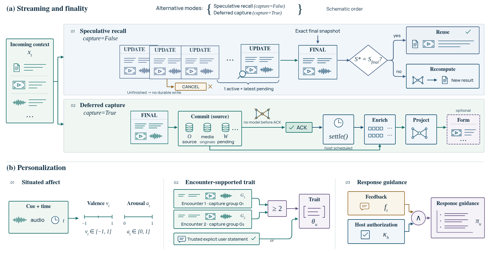

# Omni streaming and interaction memory

Connect continuous audio and video to durable event memory. `AsyncEventStream` understands
successive media chunks and commits model-confirmed complete events, preserving their original
media and time intervals. Applications with their own finality signals can instead use
`StreamEvent`:

1. An `UPDATE` is a complete current snapshot used only for speculative search.
2. A `FINAL` is a completed observation eligible for exactly one durable write.
3. A `CANCEL` or end-of-stream before finality writes nothing.

`AsyncAudioStream` and `AsyncVisionStream` map canonical capture values onto that contract.

This page owns those lifecycle boundaries. Sensor capture, stream reconnection, provider packet
decoding, pixel conversion, synchronization, and encoding remain application or adapter work.
The automatic event path chooses semantic boundaries; the explicit capture reducers use the
application's finality signals.



*From the SenseMem technical report, Figure 3. Panel (a) shows the alternative speculative-recall
and deferred-capture modes: unfinished input stays transient, while finalized capture commits
before acknowledgement and host-scheduled settlement. Panel (b) shows the downstream
[affective-memory](affective-memory.md) rules: inferred traits need independent capture groups,
and response guidance requires feedback and host authorization.*

## Choose the smallest stream API

| Need | API |
| --- | --- |
| Lazily add completed independent observations | `Memory.add_stream()` or `AsyncMemory.add_stream()` |
| Deliver an answer while the model is still writing it | `Memory.ask_stream()` or `AsyncMemory.ask_stream()` |
| Acknowledge already completed observations without waiting for models | `Memory.capture()` with `Memory.settle()`, or explicit-finality stream APIs with `capture=True` |
| Search while one query snapshot is changing | `AsyncOmniPrefetch` |
| Understand successive audio/video chunks and find complete events | `AsyncEventStream` |
| Acknowledge continuous media before semantic models finish | `AsyncEventStream.append()` with a checkpoint and host-scheduled `process()` |
| Associate speculative snapshots with final commits | `AsyncCaptureStream` |
| Normalize PCM, VAD, and ASR state | `AsyncAudioStream` |
| Normalize encoded frames and visual descriptions | `AsyncVisionStream` |

Use `AsyncEventStream` for automatic semantic boundaries, `add_stream()` for already completed
observations, and the capture reducers when explicit finality is available. Every reducer takes an
`AsyncMemory`, written `async_memory` below; the synchronous snippets assume an open `memory` plus
already-read immutable media bytes.

Partial query snapshots must be immutable: prefetch rejects `Path` atoms, whose bytes could
change while a search is running. Read a capture frame into `Blob` or use an existing `AssetRef`.
Completed durable writes still accept ordinary local `Path` content through the SDK.

The capture APIs stream observations into memory. `ask_stream()` streams an answer out; its
delivery contract is in the [memory API](api/python-memory.md#ask_stream).

## Automatic event segmentation

Supply independently decodable `EventChunk` values in time order. Their source intervals can follow
codec groups beginning at video keyframes; no wall-clock segmentation timer is required. A browser's
encoded-byte flush is not itself a playable observation or a semantic boundary. The capture adapter
demuxes and remuxes source packets, while the segmenter receives a bounded media window and returns
complete events from its beginning. A pause alone need not end a task, and an ongoing action remains
pending.

```python
from pathlib import Path

from sensemem import AsyncEventStream, Blob, EventChunk


async def video_chunks():
    for encoded_clip, occurred_at, occurred_end in codec_groups:
        yield EventChunk(
            Blob(encoded_clip, "video/mp4"),
            occurred_at=occurred_at,
            occurred_end=occurred_end,
        )


events = AsyncEventStream(
    async_memory,
    segmenter=segmenter,
    checkpoint_path=Path("capture-checkpoint.json"),
)
async for commit in events.consume(video_chunks()):
    print(commit.record.id, commit.record.occurred_at, commit.record.occurred_end)
```

Here `codec_groups` supplies independently decodable bytes and their actual source start/end
timestamps. `segmenter` is a caller-owned `EventSegmentationBackend`, such as `OpenAICompletion` configured
for a completion endpoint that accepts the supplied media. The model receives original media,
chunk order, and event times. To combine synchronized cameras and microphones, give a chunk a
tuple pairing one audio blob with one image/video blob with a shared interval. Individual encoded
image, audio, and video blobs are also accepted. No transcript or host-generated scene boundary
is required.

For a continuous source that must keep accepting media while a model is busy, separate durable
acceptance from semantic processing:

```python
async def receive_media(chunks):
    async for chunk in chunks:
        await events.append(chunk)
        # The source can acknowledge this interval now, before any model result.


async def analyze_available(*, source_ended=False):
    async for commit in events.process(end_of_stream=source_ended):
        print(commit.record.id)
```

The host schedules one analysis task when input arrives, independently of `receive_media()`.
`append()` requires a checkpoint and returns after flushing both original media and its pending
reference. It can run while that one processor is assessing earlier input. `process()` coalesces
adjacent arrived observations within its model-window and active-byte budgets; idle input does not
close the source. After all final bytes are accepted, schedule `process(end_of_stream=True)` to
request finality without forcing it. The [live demo](live-demo.md#implementation) supplies the
continuous browser adapter and background scheduling. `consume()` combines source pulls and
processing for applications that can wait between observations; its no-checkpoint usage remains
available.

The bundled adapter's event recipe v3 also preserves ordered `content_parts` and their original
or derived roles. `media_order` maps part references to the following native attachments. A
model interpretation remains a prior assessment rather than an original observation. Pending
checkpoints require their original segmenter recipe; finish them before changing recipes.

The memory instance still needs compatible native ingestion or source-backed transcript/description
routes for these original assets; the event summary does not replace media coverage.

Every confirmed event produces one or more `EPISODIC` storage records. Records split at 127 media
parts or a change in chunk context; this storage boundary does not end the semantic event. Their
original content contains only the captured media, with model text stored separately as a
`model_interpretation` part. Each record's occurrence interval and typed context describe its own part, so a kitchen
chunk remains retrievable in the kitchen even when the activity finishes in another room.

Metadata under `event_segmentation` contains `model`, `recipe`, a shared `event_id`, zero-based
`part_index`, `part_count`, the complete event's `occurred_at`/`occurred_end`, its model-generated
`summary`, `summary_coverage="unverified"`, and `supplied_modalities`. Its `chunks` list
contains each part's chunk intervals, `media_count`, original `asset_ids` in capture order, and full `context`. Group by `event_id` and
check all indices through `part_count - 1` when the application needs the complete event. A failure
between storage writes can leave a durable prefix of parts; recovery finishes the remaining parts.
Event identity includes the original capture intervals, media, segmenter recipe, and per-chunk
source/place/pose context. Equal media captured under different source contexts cannot join one
event merely because their timestamps coincide.
Checkpoint format v5 preserves these event identities, durably staged pending input with byte-size
metadata, and the storage-part bounds. Earlier v1–v4 manifests are rejected without migration; finish
their pending work with the original runtime before upgrading, or retain a complete backup for
explicit operator handling. Checkpoint format and the segmenter's event recipe have independent versions.

A single-part event includes its synopsis as explicitly unverified model interpretation. For an
event spanning several parts, the full synopsis remains in event metadata; each part's searchable
interpretation describes only its position and intervals. Whole-event activities are not copied
into a local place/time record as though observed there. There is no separately asserted global
event record. Original media can be read through [read_asset](api/python-memory.md#read_asset);
source replay excludes model interpretation text while retaining those media.

Supplying audio to the model does not prove that its synopsis retained each sound or its count.
All synopsis details remain unverified model interpretations, including positive claims and exact
counts. A caller can report what a synopsis says without treating it as verified original-media
perception. Corresponding original media or independent evidence can establish the fact; the
synopsis alone cannot. An omitted detail is unknown, not evidence of absence. `complete=True`
confirms the model-proposed boundary, not verified summary completeness across modalities.
Event interpretation and metadata state this uncertainty even when a summary confidently
describes a visual outcome.

Supply `EventChunk(..., context=ObservationContext(...))` to retain each capture's place and pose.
The helper's optional `context` callback fills missing chunk contexts when input arrives. It is not
sampled later at the event's final location. Context changes create separately scoped storage
parts while retaining the same event identity.

The model may close several events in one assessment and return one final
`EventSegment(..., complete=False)` summarizing the unfinished suffix. Later assessments use that
same original event media while it fits `max_chunks` and the active byte budget; early sounds and movement are
not replaced by a synopsis merely because another chunk arrived. Events exceeding either bound
use the explicitly untrusted interpretation plus new original media. The synopsis observation
also carries the last analyzed original chunk as motion and sound context, with its original
interval clearly labelled; this overlap adds no chunk or boundary offset. All original chunks remain
available for final storage and recovery; the continuation is neither a source observation nor a
completed event. `complete=True` is required for every durable event part. Boundary precision is
limited to chunk edges.
The final synopsis uses that same bounded assessment. Beyond `max_chunks`, completion does not
trigger a second review of every earlier original chunk, so earlier omissions can survive into the final synopsis.
Retaining source media makes later review possible without making that review automatic.

EOF requests another assessment and preserves an unfinished suffix for continuation. Source
errors, invalid boundaries, and exceeded bounds fail explicitly and retain accepted input. Model
failures leave that assessment pending for retry. With separate `append()` and `process()` calls,
source acceptance can continue within the pending-byte quota while analysis is delayed or retried.
The combined `consume()` path still waits for processing before pulling its next source value.

Cancellation drains an active segmentation request before returning. No event part is written from
that interrupted call; accepted input and any validated assessment remain resumable. Once a final
storage write starts, the capture reducer's commit-draining rule below applies.

`max_streams=32` bounds distinct stream IDs for this helper, including restored history.
`max_chunks=32` bounds observations in one model assessment, including a continuation synopsis,
and original chunks in each completed storage part; it must be at least two.
A segmenter that supplies continuations can process arbitrarily many
chunks without growing its model window or replaying all earlier media. A segmenter returning only
empty tuples eventually reaches this limit and must produce a continuation or completed prefix
before more pending input can enter the active analysis window. It never forces an event boundary.

`max_buffer_bytes=64 * 1024 * 1024` bounds one active model window or storage part when a
checkpoint is configured. Unfinished originals stay as content-addressed references on disk,
including across long continuations; only the selected originals and continuation anchor are
loaded for assessment. Completed events split into parts bounded by `max_chunks`, that byte budget,
the media-count limit, and changes in chunk context. The parts retain the same semantic event ID
and whole-event summary. Without a checkpoint, this quota still bounds all retained originals
across unfinished events and unacknowledged storage parts.
`max_pending_bytes=64 * 1024 * 1024` is a separate quota for durably staged media awaiting
analysis. Pending media is not loaded on reopen; its size and digest are checked when processing
loads it. Neither quota raises the model-window limit. A full quota fails explicitly while
previously accepted media stays durable. The 127-media limit applies to individual storage parts, not event
duration. Continuation compression is lossy; qualify its factual and temporal quality on the
intended activities, not only its bounded request size.
Each stream's chunks need timezone-aware, contiguous, nonoverlapping intervals. Separate
`stream_id` values allow interleaving and do not provide data isolation.

`capture=True` defers transcription, description, embedding, and formation to `settle()` and skips
automatic retrieval. Semantic event commits still require segmentation, but durable `append()`
acknowledgement does not wait for that model. The helper does not close the caller's segmenter.
See [the async API](api/python-streams.md#asynceventstream) and
[the backend contract](api/python-backends.md#eventsegmentationbackend).

### Resume continuous capture

With `checkpoint_path`, each accepted chunk is flushed before inference to a private manifest and
content-addressed files in `<checkpoint_path>.media/`. Validated events and delivery progress are
also saved before final writes. Reopen the same memory directory and construct the helper with the
same checkpoint path, segmenter recipe, `max_chunks`, and `max_buffer_bytes`.
Call `process()` to resume staged input and pending
assessments, or `process(end_of_stream=True)` if the source has ended; `consume()` also runs recovery
before reading its source. `events.positions` maps
each stream ID to the end timestamp of its last accepted chunk. Resume the source at that boundary;
the helper retries pending assessments and unfinished part writes before admitting more queued
observations to analysis.

The checkpoint preserves unfinished source input across process exits without declaring it a
completed memory. It requires the same physical `data_dir`; a different directory or segmenter
recipe is rejected. Only one helper may own a checkpoint, with one active semantic processor.
Concurrent `append()` calls serialize durable acceptance; overlapping `process()` calls or a
concurrent `consume()` and `process()` are rejected. Back up the manifest and its media directory
together with the memory store. Retained originals are integrity-checked incrementally on reopen
without loading the entire activity into RAM; staged pending bytes are checked when processing
loads them. Checkpoint media is removed after the
complete event's storage parts have been acknowledged; ordinary SQLite memories and assets remain.

The v5 manifest pins `max_chunks` and `max_buffer_bytes`, because changing either would change
storage-part boundaries and invalidate an acknowledgement cursor. Reopening with a different bound fails
before processing. It records `pending` references and each media reference's `size_bytes`,
alongside its digest, media type, and name. Preserve the manifest and its content-addressed media as one unit;
do not edit or replace either while an instance owns the directory. Earlier v1–v4 formats are rejected
without migration. Finish them with their original runtime before upgrading, or preserve the
checkpoint, media directory, and memory store together for explicit operator handling.

Without `checkpoint_path`, the same helper can resume after an interrupted `consume()`, but its
pending input does not survive process exit. Delivery can repeat when a storage write committed
before its checkpoint acknowledgement; the ordinary content-addressed write returns the same
memory ID instead of inserting another record.

## Add completed observations

`Memory.add_stream()` consumes a lazy iterable of `ContentInput` or `StreamInput` values. Each item
uses the ordinary `add()` path and is durable and searchable before the next item is requested. The
stream is not one transaction: a later source or item failure leaves the committed prefix intact.

Use `StreamInput` when observations need independent event time, metadata, memory type, context,
transcript, or visual description:

```python
from datetime import datetime, timedelta, timezone

from sensemem import Blob, MemoryCategory, StreamInput

started = datetime(2026, 8, 31, 9, tzinfo=timezone.utc)
observation = StreamInput(
    (
        "The user is looking for the red toolbox.",
        Blob(frame_bytes, "image/png", "frame.png"),
        Blob(audio_bytes, "audio/wav", "speech.wav"),
    ),
    occurred_at=started,
    occurred_end=started + timedelta(seconds=2),
    metadata={"source": "companion_robot", "sequence": 17},
    memory_type=MemoryCategory.EPISODIC,
)

for source_record in memory.add_stream((observation,)):
    print(source_record.id)
```

The async form accepts an `AsyncIterable` and yields with `async for`. Both forms preserve source
backpressure and identify a failing item as zero-based `contents[index]` in the public error.

Mutable ASR hypotheses, incomplete media, and repeatedly overwritten file paths are not completed
observations. Keep them out of durable `add_stream()` input.

## Fast capture

Use `capture()` instead of `add()` when the observation is final but the caller cannot wait for
transcription, embedding, indexing, and formation — a device that must acknowledge a burst of
finals, or a turn loop that would otherwise block on the slowest model. `capture()` returns after
the SQLite commit; the record becomes searchable when the host calls `settle()`.

```python
for observation in burst:
    memory.capture(observation)

while memory.settle(limit=32):
    pass
```

Continue while `settle()` returns completed work. Rows at the retry ceiling remain queued;
inspect their `attempts`, `last_error`, and `awaiting` fields with `pending_captures()`.
`awaiting="enrichment"` means vectors are pending; `awaiting="formation"` means the record is
searchable and typed formation remains. After fixing a failure, retry that record explicitly with
`settle(memory_ids=...)`, which bypasses its attempt ceiling. Claims prevent duplicate work on
one record while disjoint records can settle concurrently.

Use `add()` when the caller needs searchability on return. With `capture()`, schedule
`settle()` explicitly; retrieval and shutdown leave deferred work queued. See
[memory operations](api/python-memory.md) for failure semantics.

## Prefetch a changing query

`AsyncOmniPrefetch` wraps an open `AsyncMemory` and overlaps retrieval with an unfinished turn
without storing its partial input. Every submission is the complete current query snapshot, not a
delta:

```python
from sensemem import AsyncOmniPrefetch

prefetch = AsyncOmniPrefetch(async_memory, limit=8)
prefetch.submit((partial_text, latest_frame, current_audio_window))
prefetch.submit((newer_text, latest_frame, current_audio_window))

result = await prefetch.finalize((final_text, final_frame, final_audio_window))
hits = result.hits
```

Only one retrieval runs at a time. While it runs, a newer submission replaces the snapshot that has
not started yet. `submit` returns its request-local revision. `latest` returns the newest completed
`PrefetchResult` without waiting and remains speculative.

To display genuine recall progress during speech, consume `updates()` in a separate task. Each
`PrefetchUpdate` carries its submission `revision` and `result`; completions already superseded by
a newer input are skipped. The iterator keeps no queue, so a slow consumer sees the newest matching
completion. Compare revisions again after any application-side hydration that can await.

Pass `budget=ContextBudget(...)` to prefetch compiled evidence rather than flat search hits. In this
mode `result.bundle` contains the exact `Memory.compile()` result, including source closure,
original media references, and uncertainty. This lets a speech agent reuse the final context without
running a second compilation. Budget selection replaces the search-only `limit`; search-only
`memory_type` and occurrence-range arguments are rejected with a budget.

`finalize` returns only a result for the exact final snapshot. It reuses an already completed
result when the values match and that search succeeded; otherwise it waits for a search of the
final snapshot. It then closes that per-turn prefetcher.

Snapshots accept immutable text, `Blob`, and `AssetRef` values. Raw `Path` values are rejected
because the file may change after submission. If a turn is abandoned, `await prefetch.close()`
drops queued work and waits for any search already dispatched to the SDK's worker pool.
Cancelling that task would not stop its synchronous model or index call, so the helper drains it.

Prefetch never creates an observation record or reinforces a snapshot. Ordinary runtime
failed-query control signals can still be recorded. Call `reinforce` only after the application has
observed positive use or feedback.

## Capture-event reducer

`AsyncCaptureStream` provides the lifecycle that raw `add_stream()` lacks. Every `StreamEvent`
carries a `stream_id` (`"default"` when omitted), so interleaved microphones, cameras, or sessions
keep independent speculative state. The same ID comes back on the resulting `StreamCommit`.

| Phase | Payload | Retrieval | Durable write |
| --- | --- | --- | --- |
| `UPDATE` | Complete current immutable `ContentInput` snapshot | Speculative and coalesced | Never |
| `FINAL` | Exact final `ContentInput` or `StreamInput` | Exact-final confirmation | Once |
| `CANCEL` | None | That stream alone is discarded and drained | Never |
| EOF before `FINAL` | — | Every open stream is discarded and drained | Never |

```python
from sensemem import AsyncCaptureStream, StreamEvent, StreamPhase


async def camera_events():
    yield StreamEvent(StreamPhase.UPDATE, left_frame, stream_id="camera-left")
    yield StreamEvent(StreamPhase.UPDATE, right_frame, stream_id="camera-right")
    yield StreamEvent(StreamPhase.FINAL, left_clip, stream_id="camera-left")
    yield StreamEvent(StreamPhase.FINAL, right_clip, stream_id="camera-right")


capture = AsyncCaptureStream(async_memory, limit=8)
async for commit in capture.consume(camera_events()):
    print(commit.stream_id, commit.record.id, commit.prefetch, commit.retrieval_error)
```

`max_streams` defaults to 32 and bounds the active prefetch workers. One search runs at a time per
ID; different IDs may search concurrently. A final or cancel boundary frees that ID. The two packet
reducers additionally accept `context=`, either a fixed `ObservationContext` or a callable read once
per closed observation, because a capture stream outlives the observations it commits.

`AsyncCaptureStream`, `AsyncAudioStream`, `AsyncVisionStream`, and `add_stream()` all accept
`capture=True`, which commits each final through `capture()` instead of `add()`. That is the
complete path from continuous observation to acknowledgement: a `FINAL` acknowledged after the
SQLite commit, and enrichment deferred to `settle()`. In capture mode, automatic `UPDATE` and
`FINAL` retrieval is skipped so query models cannot delay the acknowledgement; use a separate
`AsyncOmniPrefetch` for speculative retrieval. Every `StreamCommit` then reports
`pending_settlement=True`, `prefetch=None`, and `retrieval_error=None`. New records stay out of
`search()` until settlement. The flag identifies capture mode; an idempotent capture of an existing
record preserves its readiness. Use `pending_captures()` to inspect actual outstanding work.
A `StreamInput` transcript or description is folded in at capture time,
so capture and add produce the same content-addressed record. By default, finals use `add()`
and yield searchable records.

```python
audio = AsyncAudioStream(async_memory, limit=8, capture=True)
async for commit in audio.consume(audio_packets()):
    assert commit.pending_settlement

while await async_memory.settle(limit=32):
    pass
```

If final retrieval fails, the observation still commits and `StreamCommit.retrieval_error` carries
a stable public error code, or `retrieval_failed` for an unclassified exception. Cancellation before
the final write starts stores nothing. Once that write starts, cancellation waits for the commit and
then propagates, so no worker writes after a cancelled task has returned.

`AsyncAudioStream` and `AsyncVisionStream` accept a `memory_type` and `context`. The context may be
one fixed `ObservationContext` for a static sensor or a zero-argument sampler for a moving sensor;
the sampler is read once when each observation closes, so its metric pose or symbolic `place_id`
belongs to that durable observation. Speculative updates do not persist the sampled context.

## Native audio protocol

`AsyncAudioStream` is the canonical speech-capture adapter. It accepts four immutable values:

- `PCMChunk`: interleaved WAV-compatible linear PCM plus sample rate, channels, sample width,
  timestamp, and `stream_id`;
- `VADPacket`: the complete current voice-active state;
- `ASRPartial`: the complete current ASR hypothesis, not a provider delta;
- `AcousticBoundary`: explicit `START`, `END`, or `CANCEL` finality.

```python
from sensemem import (
    ASRPartial,
    AcousticBoundary,
    AsyncAudioStream,
    AudioBoundary,
    PCMChunk,
    VADPacket,
)


async def audio_packets():
    yield VADPacket(True, stream_id="headset")
    yield PCMChunk(first_pcm, sample_rate_hz=16_000, stream_id="headset")
    yield ASRPartial("where is the red", stream_id="headset")
    yield PCMChunk(second_pcm, sample_rate_hz=16_000, stream_id="headset")
    yield ASRPartial("where is the red toolbox", stream_id="headset")
    yield AcousticBoundary(AudioBoundary.END, stream_id="headset")


audio = AsyncAudioStream(async_memory, limit=8)
async for commit in audio.consume(audio_packets()):
    print(commit.stream_id, commit.record.id)
```

PCM accumulates independently per ID and is wrapped in a standard WAV container. A native-audio
embedding backend receives changing audio snapshots directly. A text-only backend receives ASR
partials for speculative retrieval; the final hypothesis binds to the WAV through
`StreamInput.transcript`, stays in the durable record, and drives text embedding. Without an
external hypothesis, the configured transcription backend is the fallback. With neither route the
operation fails rather than dropping audio.

`VADPacket(active=False)` and `AudioBoundary.END` finalize; `CANCEL` and incomplete EOF never write.
A PCM format change inside a segment, or a buffer beyond the local asset limit, fails validation.
Normalize vendor VAD and ASR payloads to these four values instead of teaching the kernel provider
packet schemas.

## Native vision protocol

`AsyncVisionStream` is the canonical live-frame adapter. It accepts three immutable values:

- `VisionFrame`: one encoded image `Blob` plus timestamp and `stream_id`;
- `VisionPartial`: the complete current caption, OCR, or detector description, not a provider delta;
- `SceneBoundary`: explicit `START`, `END`, or `CANCEL` finality.

```python
from sensemem import (
    AsyncVisionStream,
    Blob,
    SceneBoundary,
    VisionBoundary,
    VisionFrame,
    VisionPartial,
)


async def vision_packets():
    yield VisionFrame(Blob(first_jpeg, "image/jpeg"), stream_id="camera-left")
    yield VisionPartial("a red toolbox beside the door", stream_id="camera-left")
    yield VisionFrame(Blob(latest_jpeg, "image/jpeg"), stream_id="camera-left")
    yield SceneBoundary(VisionBoundary.END, stream_id="camera-left")


vision = AsyncVisionStream(async_memory, limit=8)
async for commit in vision.consume(vision_packets()):
    print(commit.stream_id, commit.record.id)
```

State and prefetch work stay independent per ID. Each scene retains only its latest frame as the
durable keyframe, which bounds memory without imposing a hidden codec or sampler. Finalize an
encoded video through `AsyncCaptureStream` when a full clip is required.

With native image embedding, frame changes drive speculative retrieval directly. With a text-only
embedder, `VisionPartial` drives retrieval and its final value attaches to the keyframe through
`StreamInput.description`. Without a partial, a configured `VisionDescriptionBackend` describes the
final frame once, before finalization, so speculative retrieval has a query to work with. With none
of those routes, finalization fails instead of discarding the frame.

This early description prepares speculative retrieval for a text-only embedder. During ordinary
writes, a configured describer processes every not-yet-described visual regardless of embedding
modality. Its labelled text enriches the stored record and lexical search while original media
remains available.

## Interaction-derived records

Organize interaction memory with the existing three memory types:

| Derived information | Memory type |
| --- | --- |
| Explicit preference or supported stable fact | `SEMANTIC` |
| One situated interaction with event time | `EPISODIC` |
| Response guidance supported by feedback | `PROCEDURAL` |

Store the completed source observation first. Continuing with the `source_record` returned above,
application analysis can then add an ordinary record whose metadata cites the source:

```python
from sensemem import MemoryCategory

guidance = memory.add(
    "When deadline pressure is present, acknowledge it before proposing steps.",
    metadata={
        "basis": "response_feedback",
        "evidence_ids": [source_record.id],
        "confidence": 0.8,
    },
    memory_type=MemoryCategory.PROCEDURAL,
)
```

On this manual path SenseMem stores that metadata but does not interpret its provenance,
confidence, or evidence IDs; emotion, trait, and policy inference remain application work.
Configuring a `FormationBackend` enables typed, kernel-validated affect and trait proposals.
A typed response policy still requires an explicit host `apply()` operation with
`basis="response_feedback"`; formation cannot authorize it.

Keep the source observation when a derived interpretation changes. Add corrected evidence or delete
the incorrect derived record instead of presenting a rewrite as the original observation.

Applications can query roles separately when one role must not crowd out another:

```python
semantic = memory.search(query, memory_type=MemoryCategory.SEMANTIC, limit=2).hits
episodic = memory.search(query, memory_type=MemoryCategory.EPISODIC, limit=2).hits
procedural = memory.search(query, memory_type=MemoryCategory.PROCEDURAL, limit=1).hits
```

Procedural records are evidence for the application; SenseMem never executes their text.
Metadata and evidence IDs do not create an authorization or isolation boundary.

## Automatic memory formation

Configure a `FormationBackend` to propose typed records from completed observations on the same
`add` or `settle` path. The source commits first. The kernel validates source modality, spatial
binding, and evidence, then commits accepted derivations with embeddings and formation progress.
A failed formation leaves the source durable and pending for retry through `settle()`.

Formation refines the existing semantic, episodic, and procedural roles; it creates no separate
store. Use [formation configuration](configuration/lifecycle.md#automatic-memory-formation) to select a
backend and [typed context](typed-memory.md) for the
resulting record and support rules.

## Affect and personality evidence

Affect is situated evidence. A proposal may carry cue modality, valence, arousal, confidence,
validity, spatial context, and source evidence. The cue modality must exist in the source
observation, so a text-only inference cannot claim to have heard vocal tension. Preserve text,
prosody, face, posture, and environment cues separately and fuse them late.

A trait is a long-horizon claim and has a stricter visibility rule:

- a trusted explicit `USER_STATEMENT` is visible immediately;
- a `MODEL_INFERENCE` stays hidden from active search until two independent source observations
  support the same normalized subject/predicate/value claim;
- repeated extraction from one observation or shared `source_id` counts once;
- evidence changes recompute confidence and visibility;
- user-stated trait corrections retain bitemporal history.

[Typed memory](typed-memory.md) defines joint support clauses, independent alternatives, and
confidence calculation.

`get` and `list` may expose a hidden trait with `RecordSemantics.visible=False` for audit, while
ordinary search and answer exclude it. Developers can inspect why a profile did not activate without
letting one uncertain emotional episode personalize future behavior.

Response policies are typed procedural evidence, never executable code. The kernel accepts them
only from host-authorized operations with response-feedback provenance.

A spatial pose recorded on a stream observation is retrieved with `RetrievalScope`; see
[spatial scope](memory-types-time-and-decay.md#spatial-scope) for the same-frame rule and
[valid time and transaction time](memory-types-time-and-decay.md#valid-time-and-transaction-time)
for the historical axes. Formation uses the same SQLite evidence and lifecycle rules as other derived records.

## Observability

Every completed stream item emits a `sensemem.add` operation span, or `sensemem.capture` when
`capture=True`. Every speculative
search that starts emits an ordinary `sensemem.search` span. This keeps model request, token,
latency, and failure accounting comparable with non-streaming calls. See
[observability](observability.md) for the attribute contract.

Useful end-to-end measurements for a capture reducer are:

- fraction of turns with a completed matching prefetch at finality;
- final-boundary-to-context latency at p50, p95, and p99;
- fraction of finals that require another search;
- searches started per turn and maximum concurrent searches per reducer;
- retrieval quality for the final snapshot, not just earlier partials;
- `CANCEL`, EOF, or pre-commit cancellation that produced a durable record, whose target is zero.
