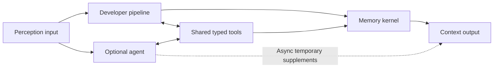

# Plugin architecture

Compose models, algorithms and knowledge sources while keeping one consistent memory system.
SenseMem supplies two routes: a fixed perception-to-memory-to-context pipeline and an optional
tool-using agent. Developers choose their composition. Either route can call the same registered
capability; an agent can asynchronously supply temporary context to the pipeline.

A VLM's ability to see a face does not supply a person's identity, and a VLM without audio input
does not transcribe audio. Register an identity lookup or ASR tool and let the chosen agent request
it when needed. The host selects implementations, devices and model revisions; SenseMem does not
rank their quality or cost or choose an implementation on the host's behalf.



The tools-to-kernel edge represents explicitly granted public SDK operations. Registration alone
grants no memory mutation authority. The kernel keeps evidence, identity and durability consistent.

## Kernel and capability model

Applications select plugins explicitly at construction. This implements the
[Swifter principle](design-principles.md#smarter--swifter--stronger): make capabilities easy to
compose and integrations easy to extend.

Applications normalize input and capture formats at their boundary. Replaceable models,
retrieval policies, context selectors, and ordered ingestion stages implement typed computations
behind the same memory operations. Plugins propose results; the kernel validates and applies them.

The kernel owns memory identity and semantics, capability routing, validation, SQLite and media-CAS
durability, the index outbox, SQLite hydration, and final context construction. A plugin may perform
inference; its protocol grants no storage authority. Custom plugin code still runs with the host
process's privileges and must be trusted.

## Implemented composition

The composition boundaries are:

- [Typed backend protocols](api/python-backends.md) integrate computations into built-in memory
  operations, with declared modalities and durable recipe identities.
- [Typed tools](api/python-tools.md) register arbitrary computations without adding a kernel slot.
  Both a fixed pipeline and [AgentRunner](api/python-agents.md) call the same registry.
- [Application factories](configuration/plugins.md) construct third-party backends and tools from
  configuration using explicitly supplied Python callables. Bundled implementations use the
  same instance-local factory catalog and resolution contract.
- [Computation policies and stages](api/python-policies.md) replace query preparation, candidate
  discovery, retrieval scoring and context selection, or add ordered interpretation stages before
  ingestion's perception and embedding. Built-in implementations use the same public protocols.

The bundled declarative entry point remains available:

```python
from sensemem import Memory

with Memory.from_config(
    {
        "data_dir": "./data",
        "embedding": {
            "provider": "sentence-transformers",
            "model": "google/embeddinggemma-2",
        },
    }
) as memory:
    memory.add("Remember this")
```

`Memory.from_config` accepts bundled provider configurations or registered application factories,
constructs owned adapters, and delegates through `Memory.from_plugins` to the constructor. Plugin bundles contain
values; protocols and declarations are validated once at assembly, before storage opens.
Inject custom and third-party backends as objects. All paths share capability validation, durable
identity checks, storage, and execution. Omitting an optional plugin adds no model call or optional
dependency. Reusing one object for several protocols is supported by the object API, and the bundled
OpenAI completion adapter can share its completion roles.

The bundled `provider` catalogs name included integrations. `MemorySpec` also accepts a
`PluginConfig` in each backend field; `factories=` resolves those names from the host catalog.
Its `tools` list adds capabilities beyond the existing slots. Configuration names registered factories; it
does not import executable code from arbitrary paths.

Backend composition is fixed for one `Memory` lifetime. Changing a backend requires closing and reopening
the instance; changing the embedder also requires a compatible durable space or a new directory.
There is no mid-operation hot swap.
Additional tools can be explicitly registered in `memory.tools`; duplicate names are rejected.
An agent run snapshots the available definitions at its start.
Routing and `Memory.capabilities` share the immutable assembly snapshot; reading the public
document never probes the plugin again. An unsupported Sentence Transformers capability returns
`False`; an exception during discovery fails assembly rather than silently removing a modality.

`GenerationRouter` composes several `GenerationBackend` objects in the answerer slot. It chooses
against the question and grounded evidence together, preferring complete native support and then
the narrowest capability set; caller order resolves ties. Text, text-plus-image and text-plus-video
can therefore use different models without application dispatch. Declarative `generation.routes`
constructs the same composition. Model rejection remains an explicit error.
The kernel probes the optional `GenerationRoutingBackend` protocol, so evidence wrappers can
preserve routing without exposing their concrete implementation to the answer plane.

`EmbeddingRouter` composes specialized encoders only when they declare the same vector space and
dimension. `EmbeddingInputSupport.embedding_routes` declares exact native combinations and
`max_assets_per_modality` limits through immutable `EmbeddingRoute` values;
when an aggregate is unsupported, the kernel uses supported atomic keys. Distinct vector spaces
cannot share this index. These compositions own each distinct nested resource once.

All consumers share source-backed native/derived routing. A caption or transcript can supply text
to embedding, queries, generation and formation while original assets remain durable. Required
conversion is automatic when a matching plugin exists; `query_vision` separately enables optional
supplemental retrieval routes. A transcript describes speech, not unseen video content.
Routing checks each attachment separately. Existing source-labelled captions and transcripts remain
usable after reopening without their producer. Removing a speech plugin preserves the stored
recipe and cached identity evidence; reattaching an incompatible recipe still fails explicitly.
Embedding model names are diagnostic: compatibility depends on the declared space and dimension,
so composing or reordering compatible encoders does not require re-ingestion.
Partial descriptions do not cover other assets, and an empty transcript supplies no fallback.
Lexical queries use available speech-to-text preparation without calling the query embedder.

## Kernel and plugin boundary

Computation plugins own model and runtime details such as device, precision, batching,
thresholds intrinsic to that model, or a caller-supplied remote SDK client. Additional OCR,
emotion or visual-grounding tools can be registered immediately with typed input and output.
An `IngestionStage` can add labelled derived interpretations through the ordinary validated write
path. Promoting results into factual assertions, identity, consent, or other durable semantics
continues to require the corresponding typed proposal contract.

`QueryPolicy` replaces query rewriting and representation selection; `Querying` validates and
executes embedding requests against leased assets and declared capabilities. `CandidateSource`
replaces discovery through a bounded native read port or external local-memory references.
The kernel fixes request scope and hydrates every candidate from authoritative SQLite records.

`RankingPolicy` replaces query-local scoring over hydrated candidates. The kernel retains candidate
identity, observation-confidence scaling, relevance and ambiguity admission, and final hydration.
`ContextSelector` proposes anchor IDs; the compiler retains all authorized candidates for conflict
detection and admits only complete evidence under the requested budget. Custom selection cannot
hide a conflict by omitting one side or replace a record with altered content. These computations
have no store handle, and invalid proposals fail explicitly. Defaults use the same plugin paths.

`memory_tools(memory)` lends read-only perception, identity lookup, search and context compilation
to an agent. `transcription_tool(memory, backend)` exposes an existing speech backend through the
same registry. Custom media stages use `memory.prepare_input(...)` to lease verified assets for
the duration of a synchronous context manager, without writing a memory record.

`AsyncContextSource` runs an application-supplied async context producer. Revision tracking drops
stale completions. The host passes its current supplements to `compile(supplements=...)`; budget,
freshness and expiry apply before rendering. Supplements never become durable facts implicitly.
See [context composition](context-compilation.md) and [agent composition](api/python-agents.md).

Assembly validates configuration and backend declarations; value constructors validate their
fields, including scope and spatial constraints. Internal helpers consume those validated values.
Model output validation precedes durable effects, with embedding decoding in the adapter and L2
normalization in the kernel. The store validates persisted data and FP32 encodings; operation-specific
checks enforce current evidence eligibility and budgets.

Adapters classify provider errors and own their request retry budgets. The kernel makes one
vision call per batch, propagates failures of required modality conversion, and may skip failed
optional enhancement when another usable representation exists. Storage translation handles
concrete I/O, database, capacity and persisted-data errors; internal programming failures remain
visible to the outer error boundary.

`RerankingBackend` is an optional computation plugin with explicit `reranking_capabilities`.
It receives a query and ordered documents as `ModelInput` values and returns an equally sized
tuple of finite relevance scores. The retrieval plane owns
SQLite hydration and filtering, eligibility, exact source-window selection, candidate identity,
and final ordering. It automatically includes supported text and original media, protects candidate
files with temporary leases and preserves captioned originals. Inputs with no supported content
are unscored; other candidates retain their positions. A reranker cannot introduce records, change source IDs, bypass the relevance or ambiguity
gate, or rewrite stored content. Invalid results and model failures are explicit errors rather
than silent fallback. Request-local scores appear separately as `RetrievalCandidateTrace.reranking_score`;
the existing bounded score keeps its meaning.

SQLite, the media CAS, the durable outbox, and Zvec are not public plugins. They have one supported
implementation, and abstracting them now would add indirection without a second product use case.
Metadata remains application data, never an execution, isolation, or authorization boundary.

A plugin whose output the kernel persists must declare that output's *space* — `embedding_space`,
`transcription_space`, `face_space`, `formation_space`, `vision_space`. The kernel caches derived
work per asset and space, so the space is what stops two recipes from sharing one result; the
plugin owns it because only the plugin knows what its recipe is. It is not the model name: a
describer that edits its prompt, or a transcriber that changes its keyword list, produces different
output from the same model and must return a different space. Declaring a stable space over a
changed recipe is the one failure the kernel cannot detect, because a stale derived value is
indistinguishable from a fresh one once it is inside a searchable document.

Request-local reranking scores are not persisted derivations and need no `*_space`. The
`reranking_model` property identifies the loaded model for diagnostics. Changing a reranker
requires reopening the instance but does not change stored embeddings or require re-ingestion.

`VLLMReranker` implements the same contract over HTTP. It owns and closes its transport, including
an injected client; the server owns model loading, revision pinning, and media preprocessing.
Declare that server's capabilities and retain its identity with evaluation results.

`VisionDescriptionBackend.describe` returns plain observation text. Text beginning with `Fact:`
has no identity side effect. The optional `VisionAnalysisBackend.describe_analysis` returns typed
`VisualDescription(text, facts, speaker_names)` values. `SpeakerName(speaker_label, name)` is an
explicit proposal about the source-local diarised label. The identity plane validates those
proposals, preserves existing names, and owns auditable, reversible `IDENTIFY` writes and all
cross-modal merges. The bundled OpenAI adapter translates its provider output into these values.
The kernel stores typed descriptions in the `typed-v1` cache format.

`EvidenceGeneration` composes any generation backend with independent `MediaSelectionBackend`
and `SourceMetadataBackend` implementations. The kernel owns bounded selection and evidence
preservation; `OpenAICompletion.select_media` supplies only the diagnostic computation.
`GazetteerEnricher` implements local source metadata lookup. `GenerationMediaBackend` optionally
reports which original assets fit a provider request before enrichment. Metadata is untrusted
request context and never becomes a durable fact.

The optional `server` and `mcp` dependencies are packaging boundaries, not plugins. REST, MCP, and
the product CLI remain thin transports over the application-composed `Memory`.

`Memory.add_stream` repeats the existing durable `add` operation over completed observations.
`AsyncOmniPrefetch` is a lifecycle helper over the same `AsyncMemory.search`. For continuous media,
`AsyncEventStream` calls an explicit `EventSegmentationBackend` to understand the pending window
and choose complete semantic events; its output is validated before ordinary durable writes.
`OpenAICompletion` implements the backend, whose model and recipe are preserved with each event.
The caller owns the segmenter. Sensor capture, encoding, synchronization, and frame selection
stay with the application. Explicit capture reducers still accept host finality. See
[the streaming contract](omni-streaming-and-interaction-memory.md#automatic-event-segmentation).

## Admission rule

A new kernel-semantic backend protocol is admitted only together with all of:

1. A concrete implementation in `src/`, not a test double.
2. A reachable caller on a product path a user invokes, not only on an adjacent or optional one.
3. Declared accepted modalities and typed output.
4. Provenance, configuration, resource lifecycle, concurrency behavior, privacy boundary, and
   failure mapping.
5. Tests that exercise the capability through the public product path.

`FaceBackend` illustrates this rule: the local OpenCV adapter supports recognition and naming
through the public identity API, with product-path tests for that integration.

Application tools need no bundled implementation, new backend protocol or change to `src/`.
Their Pydantic contracts, explicit registration and resource ownership are the extension boundary.

`VisionDescriptionBackend` meets the rule through `OpenAICompletion.describe`, the optional
[`vision` configuration](configuration/models.md#visual-descriptions), and the `add`/`add_many` product path.

`RerankingBackend` meets it through `Qwen3VLReranker` and `SentenceTransformersReranker`, the optional
[`reranking` configuration](configuration/models.md#semantic-reranking), and the shared retrieval path
used by `search`, `ask` and `compile`. The plugin supplies aligned relevance scores; the kernel owns
source identity, filtering and result ordering. Both adapters pin checkpoint revisions, disable
remote code and close with their owning `Memory`. Their dependencies and runtime controls live
in the configuration guide. Product-path tests establish integration; task-specific quality
improvements require separate evaluation.

## Embodied integration boundary

SenseMem gives embodied applications memory representation, retrieval, provenance, and temporal
validity. The host supplies planning, skill execution, verification, edge/cloud placement, and
robot control. Procedural memories provide evidence for that host; their text is never executed.

New entity, relation, or spatial projections must remain derived from authoritative records and
demonstrate a retrieval benefit through SenseMem's public API.

Interaction memory uses the existing semantic, episodic, and procedural roles. The current
`FormationBackend` can propose affect and trait records; additional analysis must preserve the
representation described in [affective memory](affective-memory.md). Response policies require
host-authorized operations. Derived records use the kernel's validated write path and retain
evidence provenance. Plugins cannot bypass durability or reinterpret metadata as routing,
isolation, or trust.

## Extending the runtime

Typed declarative construction makes bundled adapters concise; explicit construction keeps custom
dependencies, lifecycle, privacy, and hardware selection visible. Both require reopening `Memory`
to change composition.

Define replaceable decisions separately from mandatory consistency rules. New computation should
use a typed proposal boundary and share the default implementation's assembly and execution path.
Keep source identity, evidence validation, SQLite commits, index outbox ordering, and final
admission in the consistency kernel. An unrestricted hook around a transaction is not a substitute
for a computation contract.

Add package entry-point discovery only when an independently distributed plugin requires it. Add a
new public capability only with a concrete adapter plus lifecycle, failure, privacy, provenance, and
product-path tests. Add richer evidence or relationship storage only when the executable embodied
loop demonstrates that existing records cannot represent the required state without loss.
