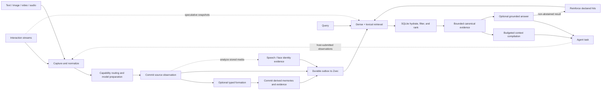

# Product capabilities

SenseMem is a **unified Context & Memory layer for agents, across devices, modalities, and models**.
It organizes information from digital interactions and the physical world into evolving memory,
then supplies evidence-backed context for the agent's current task.

Context is information needed now; memory is information retained and organized across time.
The product loop is **receive context → form and maintain memory → recall for a task → build
useful context**. Applications decide which observations to retain and when to run maintenance.

SenseMem 0.3 implements this direction as an embedded, local-first runtime. Text, image, video, and
audio can stand alone or combine in an ordered input when the configured backends support the
route. Original media and its time, place, and identity context remain available as evidence.
Persistent state stays in one local memory domain; inference uses explicitly configured local or
remote model backends. This page describes what the current release implements.
For future direction and decision criteria, see [product goals and design
principles](design-principles.md). To run the shortest working path, start with the
[quick start](quickstart.md).

## Positioning and suitable use cases

SenseMem fits applications that need to connect current interactions with durable, inspectable
memory. Its intended sources include software agents, smart glasses, phones, robots, and other
intelligent hardware. Each source enters through application-owned adapters; no device-specific
SDK or cross-device synchronization service is bundled. Representative uses include:

- Chatbots, coding agents, personal assistants, and voice agents that need recall, explicit
  deletion, and evidence-backed context across sessions.
- Smart-glasses and phone applications that normalize selected text, images, audio, or video into
  observations with time and place context.
- Companion and desktop robots that remember events, places, people, preferences, and response
  guidance from mixed sensor observations.
- Multimodal agents that must retain original media while using native embeddings, transcripts, or
  visual descriptions for retrieval.
- Agent hosts that need the same memory semantics through Python, REST, MCP, or a machine-readable
  command line.
- Edge or private deployments that want local authoritative state while choosing local and remote
  inference capabilities independently.

Deployment requires compatible Python, dependencies, and model runtimes. Modality coverage and
quality depend on the configured backends; spatial metadata does not establish native 3D-scene
support. See [design principles](design-principles.md) for the product's evaluation criteria.

SenseMem adds the following product properties beyond a raw vector-search component:

| Product choice | Implemented behavior | Why it matters |
| --- | --- | --- |
| Memory semantics | Semantic, episodic, and procedural roles; optional typed entity, event, state, relation, affect, trait, and response-policy records | Applications retrieve memories by cognitive role and can preserve how derived knowledge was formed. |
| Multimodal input | One ordered content contract for text, image, video, audio, and mixed `omni` observations | Configured backends handle supported single or combined inputs while source media remains available. |
| User-owned input forms | Applications normalize custom capture objects, sensor events, and interaction formats at the boundary | Product-specific input can evolve without widening the memory kernel to unvalidated objects. |
| Evidence before generation | Retrieval returns canonical records; answers report backend-declared evidence and abstention | The caller can inspect the delivered sources and assess whether they support an answer. |
| Task-ready context | `compile()` selects evidence into typed sections within explicit item, character, and media budgets | An agent can build its own prompt from a structured bundle without requiring SenseMem to generate the answer. |
| Embodied context | Event intervals, valid time, knowledge time, metric pose, symbolic place, speech, faces, and local identities | Recall can be constrained by when and where something was true or observed, and by who appeared. |
| Durable local authority | SQLite and immutable media are authoritative; Zvec is a rebuildable search projection | Index loss or stale index IDs do not redefine the stored truth. |
| One execution plane | SDK, REST, MCP, and CLI adapters dispatch to the same `Memory` kernel | Shared operations keep the same IDs, defaults, result meanings, and failure semantics. |
| Plugin composition | Typed backend protocols declare their supported modalities; routing does not infer capability from provider names | A deployment can change model providers without forking storage or memory semantics. |
| Developer- and agent-friendly APIs | Typed SDK values, OpenAPI, self-described MCP tools, structured CLI results, stable errors, and bounded output | Humans and agents can discover and call the same operations without scraping prose or logs. |

## Capability map

| Area | Supported behavior | Requirement | Owning documentation |
| --- | --- | --- | --- |
| Capture | `add`, transactional `add_many`, incremental `add_stream`, deferred `capture`/`settle`, and async capture reducers | An embedding backend is required; media handling depends on the selected route | [Core concepts](concepts.md#content-becomes-a-record) |
| Formation | Optional source-grounded typed memories with lineage, evidence, validity, visibility, and supersession | A `FormationBackend`; disabled when omitted | [Memory formation](configuration.md#automatic-memory-formation) |
| Storage | SQLite records and FP32 embeddings, SHA-256 media CAS, durable index outbox, and Zvec projection | One writable local `data_dir` | [Architecture](architecture.md#durable-state) |
| Retrieval | Dense and lexical candidates, composite retrieval keys, memory-type filters, event-time overlap, bitemporal and spatial scope, relevance and ambiguity gates | The configured embedder must support a valid route for the query | [Memory types, time, and decay](memory-types-time-and-decay.md) |
| Evidence | Ranked `SearchHit` records, typed source evidence for formed memories, and opt-in bounded retrieval traces | Core; richer typed evidence requires formation | [Python retrieval contract](api/python-sdk.md#memory-operations) |
| Context | Evidence-closed `ContextBundle` with typed sections, conflicts, unknowns, and optional exact raw excerpts | No generation backend required | [Context compilation](context-compilation.md) |
| Memory management | Explicit consolidation, correction, reinforcement, cognitive forgetting, operation history, and rollback | Proposal generation needs a `ConsolidationBackend`; the host schedules the loop | [Memory management](api/python-sdk.md#memory-management-operations) |
| Answer | Grounded `ask` with explicit abstention and the canonical hits actually used | A `GenerationBackend` | [Core concepts](concepts.md#retrieval-can-return-no-evidence) |
| Reinforcement | Explicit positive feedback plus automatic reinforcement of backend-declared hits from non-abstained answers; optional recency decay | Core policy; automatic answer reinforcement is configurable | [Decay and reinforcement](memory-types-time-and-decay.md#decay-and-reinforcement) |
| Omni-modal analysis | Native modality routing, transcription fallback, speech analysis, visual-description hook, and face analysis | Route-specific embedding, speech, vision, or face backends | [Configuration](configuration.md) |
| Identity | Durable voice and face exemplars, local identity resolution, names and relationships, corroborated face/voice linking, unlinking, and person erasure | A `SpeechBackend` and/or `FaceBackend` for observations | [Cross-modal identity binding](api/python-sdk.md#cross-modal-identity-binding) |
| Data-subject operations | Host-recorded consent, subject export, biometric erasure, and explicit retention passes | Host authority; network routes require opt-in; consent is not an access-control filter | [Data-subject rights](api/python-sdk.md#data-subject-rights) |
| Interaction | Speculative recall over changing observations; final-boundary persistence for generic, audio, and vision streams | `AsyncMemory` and application-supplied capture events | [Omni streaming and interaction memory](omni-streaming-and-interaction-memory.md) |
| Operations | Capability reporting, pagination, deletion, index rebuild and optimization, backup/restore procedures, and OpenTelemetry spans | Exporting telemetry requires an SDK/exporter configured by the host | [Operations](operations.md) |

## End-to-end memory loop

### Capture and retrieval

Use `add()` for a searchable result on return, `add_many()` for an atomic source batch, and
`add_stream()` for completed observations with a durable prefix if a later item fails.
`capture()` acknowledges a source before model work; the host later schedules `settle()`.
Content-addressed IDs make repeated canonical input idempotent.

Native media, source-labelled captions, and transcripts share capability-based routing. Original
media remains available as evidence. A configured former can propose typed assertions only after
the source commits; those assertions retain validated evidence and lineage.

Search combines the configured dense and lexical routes, then hydrates and filters candidates
from SQLite. Role, occurrence time, bitemporal validity, person, symbolic place, and metric scope
can restrict recall. Scores rank evidence within a request; relevance and ambiguity gates can
return no hits. Optional reranking changes ordering without changing stored embeddings.

### Context, answers, and maintenance

`compile()` delivers evidence in typed sections under explicit budgets, including source closure,
conflicts, and unknowns. `ask()` additionally calls a generation backend and reports abstention and
backend-declared evidence. The default text adapter reports the fitted grounding pool; structured
answering can report a smaller support subset. Neither establishes factual support by citation alone.

Optional formation and consolidation propose memory changes; the kernel validates and logs their
accepted effects. Cognitive forgetting and rollback preserve inspection and recovery. Physical
deletion and retention require host operations and have different recovery limits.

### Identity and continuous input

Configured speech and face backends produce local observations and identities. Naming adds a
searchable assertion; corroborated voice/face links can be reversed. Consent statements, subject
exports, biometric erasure, and retention are explicit host operations. Identity matching is
model-dependent and does not provide authentication or access control.

Async capture helpers coalesce speculative snapshots and persist only finalized observations.
Audio and vision reducers accept application-supplied packets and boundaries; device control and
segmentation remain outside the runtime. See the [streaming guide](omni-streaming-and-interaction-memory.md)
and [identity contract](api/python-sdk.md#cross-modal-identity-binding) for details.

## Python, REST, MCP, and CLI surfaces

Follow the [Python SDK](api/python-sdk.md), [REST](api/rest.md), [MCP](api/mcp.md), and [CLI](api/cli.md) references for
arguments, schemas, limits, and errors.

| Capability | Python `Memory` | REST | MCP | `sensemem` CLI |
| --- | --- | --- | --- | --- |
| Add one | `add` | `POST /v1/memories` | `add_memory` | `add` |
| Add atomic batch | `add_many` | `POST /v1/memories/batch` | — | `add-many` |
| Add completed stream | `add_stream` | — | — | `add-stream` |
| Capture without a model | `capture` | `POST /v1/capture` | — | `capture` |
| Settle captured records | `settle` | `POST /v1/settle` | — | `settle` |
| Report unfinished captures | `pending_captures` | `GET /v1/pending_captures` | — | `pending-captures` |
| Search | `search` | `POST /v1/memories/search` | `search_memories` | `search` |
| Answer | `ask` | `POST /v1/answers` | `ask_memory` | `ask` |
| Answer incrementally | `ask_stream` | `POST /v1/answers/stream` | — | — |
| Compile context | `compile` | `POST /v1/context` | `compile_context` | `compile` |
| Get by ID | `get` | `GET /v1/memories/{memory_id}` | `get_memory` | `get` |
| List newest | `list` | `GET /v1/memories` | `list_memories` | `list` |
| Delete memory | `delete` | `DELETE /v1/memories/{memory_id}` | `delete_memory` | `delete` |
| Reinforce | `reinforce` | `POST /v1/memories/reinforce` | `reinforce_memories` | `reinforce` |
| List due deliberation | `consolidation_candidates` | — | — | `consolidation-candidates` |
| Deliberate over evidence | `consolidate` | — | — | `consolidate` |
| Process due candidates | `consolidate_pending` | — | — | `consolidate-pending` |
| Apply one operation | `apply` | — | — | `apply` |
| Judge one operation | `record_outcome` | — | — | `record-outcome` |
| Cognitively forget | `forget` | — | — | `forget` |
| Undo one operation | `rollback` | — | — | `rollback` |
| Read the operation log | `operations` | — | — | `operations` |
| Perception | `perceive` | `POST /v1/perception`* | `perceive_memory` | `perceive` |
| Name identity | `register_identity` | `POST /v1/identities`† | `register_identity` | `register-identity` |
| Read identity | `identity` | `GET /v1/identities/{id}`† | `get_identity` | `identity` |
| Reverse merge | `unlink_identity` | `POST /v1/identities/{id}/unlink`† | `unlink_identity` | `unlink-identity` |
| Erase person | `forget_identity` | `DELETE /v1/identities/{id}`† | `forget_identity` | `forget-identity` |
| Record consent | `record_consent` | `POST /v1/identities/{id}/consent`† | — | `record-consent` |
| Read consent | `consent` | `GET /v1/identities/{id}/consent`† | — | `consent` |
| Export a subject | `export` | `GET /v1/export`† | — | `export` |
| Apply retention | `apply_retention` | `POST /v1/retention`† | — | `apply-retention` |
| Rebuild index | `reindex` | — | — | `reindex` |
| Optimize index | `optimize` | — | — | `optimize` |
| Declare capabilities | `capabilities` property | `GET /healthz` | — | `--explain` resolves composition |
| Validate loaders | — | — | — | `doctor` |

REST exposes thirteen `/v1` product routes plus `/healthz`, or twenty-two when the host also
enables `create_app`'s `embodied_operations` (* above) and `identity_operations` († above)
switches. MCP exposes thirteen tools by default; its host can withhold tool groups. The product
CLI exposes the SDK operations except `ask_stream`, plus `doctor`. `AsyncMemory` mirrors the
SDK operations and adds async stream consumption. See each reference for transport-specific
defaults and authority switches.

## Deployment and isolation model

SenseMem supports three practical topologies, all with one owner for one physical data directory:

| Topology | Use | Boundary |
| --- | --- | --- |
| Embedded Python | One application process owns memory directly | Keep one long-lived `Memory` or `AsyncMemory` and close it on shutdown. |
| REST owner | Other processes need HTTP access | Construct one caller-owned `Memory`, run one ASGI worker, and add network security outside SenseMem. |
| MCP owner | An agent host needs typed tools | Prefer stdio; secure SSE or streamable HTTP as a network service. |

The operating-system lock is non-blocking: a second live owner of the same directory fails
immediately, while different directories operate concurrently. A `Memory` created before `fork()`
cannot be reused in the child. Network filesystems, shared-volume multi-writer access, and several
independent REST/MCP/Python processes over one directory are unsupported.

Physical directories are the isolation boundary. Allocate a different directory for every
application, tenant, worker, benchmark case, or security domain that must not share records.
Metadata is not a tenant selector. Filesystem permissions, encryption, authentication,
authorization, TLS, quotas, rate limits, retention, and audit policy belong to the host deployment.

Back up SQLite and `assets/` together; Zvec may be rebuilt. The detailed topology, hardening, and
lifecycle guidance is in [deployment](deployment.md), with backup and repair procedures in
[operations](operations.md).

## Generality and extensibility

SenseMem keeps a stable memory kernel and varies computation at typed capability boundaries:
`EmbeddingBackend`, `RerankingBackend`, `GenerationBackend`, `StreamingGenerationBackend`, `TranscriptionBackend`,
`SpeechBackend`, `VisionDescriptionBackend`, `FaceBackend`, `FormationBackend`, and
`ConsolidationBackend`. Routing reads declared modalities and stable model-space identities, while
the kernel retains control of validation, record identity, durability, evidence, final hydration,
and lifecycle.

Applications can compose those objects directly, group them in `MemoryPlugins`, or use
`Memory.from_config` for the bundled provider catalog. Current bundled adapters cover
Sentence Transformers embedding and text reranking, local Qwen3-VL and remote vLLM reranking, OpenAI-compatible
embedding/generation/transcription/formation/vision/consolidation, FunASR speech, and OpenCV face
analysis. Exact extras, provider fields, model revisions, and license constraints are maintained in
[configuration](configuration.md).

This boundary generalizes in three directions without changing the memory API:

- A sensor or application object is normalized into `ContentInput`, `StreamInput`, or an async
  capture packet outside the kernel.
- A local, edge, or remote inference implementation can satisfy the same narrow backend protocol
  and declare only the modalities it actually supports.
- A new transport can call the same `Memory` operations and preserve their IDs, results, defaults,
  and errors rather than reimplementing memory policy.

Composition is fixed for one `Memory` lifetime. There is no global registry, package discovery, or
live backend swap. SQLite, the media CAS, and Zvec are internal components, not public storage
plugins. See [plugin architecture](plugin-architecture.md) for the admission rule for a new
capability.

## Limits and non-goals

- SenseMem is an embedded runtime, not a hosted memory service, distributed database, or
  multi-writer synchronization layer.
- It does not provide tenants, accounts, authorization, authentication, TLS, rate limiting, quotas,
  or an audit service. A `data_dir`, not metadata, is the isolation unit.
- It does not fetch remote media. REST and MCP also do not accept host filesystem paths; the
  application must enforce its own network and download policy before creating a `Blob`.
- Multimodal coverage is the intersection of input and configured backend capabilities. Unsupported
  routes fail; installing an extra does not by itself configure a model.
- Formation is optional model inference, not guaranteed truth. Its records retain basis,
  confidence, source evidence, model, and recipe so callers can apply their own trust policy.
- Search can return no evidence. Scores are request-local ranking values, not calibrated
  probabilities, and retrieval quality depends on the chosen embedding and generation recipes.
- Voice and face matching are local, model-dependent similarity decisions, not biometric
  authentication. Cross-modal linking is corroborated and reversible but cannot be made infallible.
- `delete` and `forget_identity` update live authoritative state; they are not secure erasure from
  SQLite free pages, WAL files, filesystem snapshots, or backups. See the
  [security model](../SECURITY.md#storage-deletion-and-backups).
- Typed lineage and evidence are a SQLite projection, not a graph database, relationship query
  language, or traversal service.
- Procedural and response-policy memories are evidence for an agent. SenseMem never executes them
  as code or robot actions.
- SenseMem is not an agent framework, planner, skill runner, sensor stack, robot controller,
  foundation model, model trainer, GPU scheduler, or automatic edge/cloud router.
- `AsyncMemory` is a thread-delegating facade over the same synchronous consistency core; it does
  not make synchronous provider SDKs natively asynchronous.
